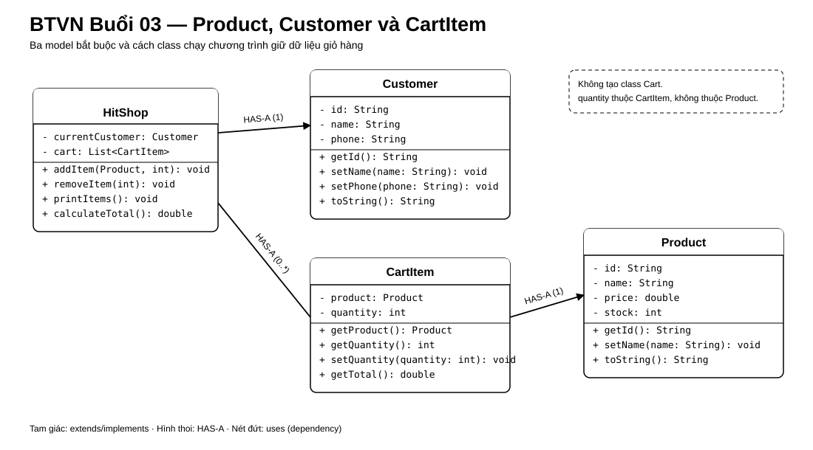

# Bài Tập Về Nhà — Buổi 03

## Bài Bắt Buộc — Mô Hình Hóa Mặt Hàng Và Giỏ Hàng Bằng Object

### Kế Thừa Từ Buổi 02

Tiếp tục đúng file `HitShop.java`, menu và repository đã dùng ở buổi 2; bài chạy bằng JDK 17. Giữ các chức năng thêm, xóa, xem giỏ và tính tổng, nhưng thay ba list song song bằng các object `Product` và `CartItem`. Bổ sung `Customer` để biểu diễn người đang sở hữu giỏ hàng.

### Bài Toán

Thay dữ liệu rời của giỏ hàng buổi 2 bằng các object có trách nhiệm riêng. Chương trình vẫn chạy trên console; phạm vi gồm hai sản phẩm có sẵn, một khách hàng hiện tại và một giỏ hàng.

### Các Class Và Quan Hệ Bắt Buộc

- `Product`: field `id`, `name`, `price`, `stock`, đều private. Constructor nhận đủ bốn giá trị. Có getter cho cả bốn field; chỉ `name`, `price`, `stock` có setter. `toString()` trả dạng `P01 | Áo thun | 150000.0 | tồn: 20`.
- `Customer`: field `id`, `name`, `phone`, đều private. Constructor nhận đủ ba giá trị; có getter cho cả ba và setter cho `name`, `phone`. `toString()` trả dạng `C01 | Linh Nguyễn | 0900000001`.
- `CartItem`: field `product` kiểu `Product` và `quantity` kiểu `int`, đều private. Constructor nhận hai giá trị; có `getProduct()`, `getQuantity()`, `setQuantity(int quantity)` và `getTotal()` trả kết quả của `product.getPrice() * quantity`.
- Quan hệ: `CartItem` HAS-A `Product`; giỏ hàng là `List<CartItem>`. Chương trình giữ đúng một biến `currentCustomer` kiểu `Customer` và một list giỏ hàng; không tạo class `Cart` hoặc lưu số lượng mua trong `Product`.
- Tạo package `model` cho ba class trên. `HitShop` nằm ngoài package `model`, import và sử dụng các object thông qua constructor/method `public`.
- Tên class chạy chương trình vẫn là `HitShop`; giỏ được giữ trong một `List<CartItem>`.

### Cấu Trúc Source

Tổ chức source tối thiểu như sau:

```text
src/
├── HitShop.java
└── model/
    ├── Product.java
    ├── Customer.java
    └── CartItem.java
```

Ba file trong thư mục `model` phải có dòng `package model;`. `HitShop.java` import `model.Product`, `model.Customer`, `model.CartItem`, `java.util.List` và `java.util.ArrayList`.

### Sơ Đồ Lớp Và Quan Hệ



Hình thoi tại `HitShop` thể hiện chương trình giữ nhiều `CartItem`; mỗi `CartItem` tham chiếu đúng một `Product`. Không tạo thêm class `Cart`.

### Method Và Hành Vi Menu

Giữ đúng bốn method sau:

```java
static void addItem(Product product, int quantity)
static void removeItem(int index)
static void printItems()
static double calculateTotal()
```

Hai field chính trong `HitShop`:

```java
private static final Customer currentCustomer =
        new Customer("C01", "Linh Nguyễn", "0900000001");
private static final List<CartItem> cart = new ArrayList<>();
```

- Tạo hai object `Product` `P01`, `P02` một lần khi chương trình bắt đầu và tái sử dụng đúng các object này khi thêm vào giỏ.
- Lựa chọn `1` in mã/tên hai sản phẩm, yêu cầu nhập mã và số lượng, sau đó gọi `addItem(product, quantity)`. Có thể dùng `if/else` hoặc `switch` để chọn object theo mã.
- Mã khác `P01`, `P02` phải báo `Không tìm thấy sản phẩm.` và không thay đổi giỏ. Nếu số lượng nhập vào nhỏ hơn hoặc bằng 0, báo `Số lượng phải lớn hơn 0.` và không thay đổi giỏ.
- Mỗi lần thêm tạo một `CartItem` mới; chưa gộp các dòng có cùng Product.
- Lựa chọn `2` nhận số thứ tự đang hiển thị và gọi `removeItem(displayNumber - 1)`. Số thứ tự không tồn tại phải báo `Không tìm thấy mặt hàng.` và không thay đổi giỏ.
- Lựa chọn `3` in `currentCustomer` trước, sau đó in các dòng giỏ. Nếu giỏ rỗng, báo `Giỏ hàng đang trống.`.
- Lựa chọn `4` in tổng do `calculateTotal()` trả về; giỏ rỗng có tổng bằng `0`.
- Giữ cách xử lý lựa chọn menu sai và lựa chọn `0` của buổi 2.

Buổi này chưa kiểm tra `quantity` có vượt `stock` và chưa trừ tồn kho khi thêm vào giỏ. Thay đổi quantity của `CartItem` không được tự làm thay đổi stock của `Product`; quy tắc cập nhật tồn kho sẽ được phát triển ở buổi sau.

### Dữ Liệu Chuẩn Và Kết Quả

- Product: `P01 / Áo thun / 150000 / 20`; `P02 / Bình nước / 50000 / 10`.
- Customer: `C01 / Linh Nguyễn / 0900000001`.
- Khai báo đúng một biến `currentCustomer` giữ object Customer chuẩn ở trên.
- Giỏ mẫu: `P01 × 2`, `P02 × 1`. Khi in giỏ, mỗi dòng phải có số thứ tự, mã, tên, đơn giá, số lượng và thành tiền; tổng giỏ là `350000`.
- Một `CartItem` chỉ chứa đúng một `Product` và một số lượng. Khi thay đổi quantity của CartItem, stock của Product không tự đổi.

Output tối thiểu của giỏ mẫu:

```text
Khách hàng: C01 | Linh Nguyễn | 0900000001
1. P01 | Áo thun | 150000.0 | SL: 2 | Thành tiền: 300000.0
2. P02 | Bình nước | 50000.0 | SL: 1 | Thành tiền: 50000.0
Tổng tiền: 350000.0
```

### Nộp Bài

Nộp toàn bộ source của `HitShop` và ba class model theo đúng package, link repository GitHub và ảnh chụp hoặc nội dung output giỏ chuẩn có tổng `350000`.

## Nâng Cao — Bài Tự Chọn

- Bổ sung field `private static int count` để đếm số đối tượng `Product` đã tạo. Constructor tăng `count` sau mỗi lần tạo đối tượng; method `public static int getCount()` trả về giá trị hiện tại. Sau khi tạo P01 và P02, `Product.getCount()` trả về `2`.
- Thêm kiểm tra trong setter: `name` không được rỗng, `price` phải lớn hơn 0 và `stock` không được âm. Phần bắt buộc chưa yêu cầu xử lý exception cho dữ liệu nhập từ bàn phím.
- Lập bảng so sánh `private`, default, `protected`, `public` khi thành viên được dùng trong cùng class, cùng package, class con khác package hoặc nơi khác; các field bắt buộc của model vẫn là `private`.
