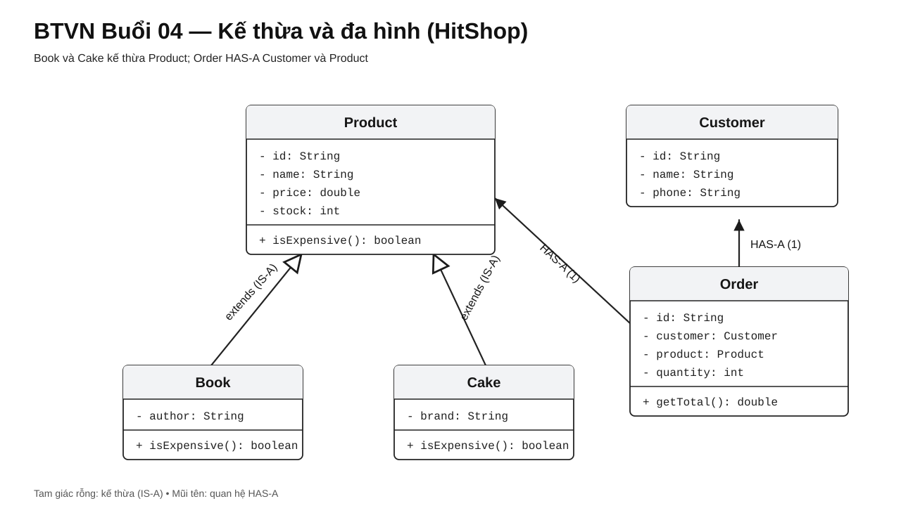

# 🚀 BTVN BUỔI 04: KẾ THỪA VÀ ĐA HÌNH — HITSHOP

## I. Tổng kết buổi trước

Ở buổi 3, chúng ta đã làm quen với lập trình hướng đối tượng (OOP) thông qua các kiến thức: **Class, Object, Constructor, `this`, Getter/Setter, HAS-A và Static**.

Chúng ta đã vận dụng những kiến thức này để xây dựng chương trình **HitShop**, mô phỏng hoạt động quản lý đơn hàng của một cửa hàng.

Hệ thống gồm 4 class:

- **Product:** Đại diện cho sản phẩm mà cửa hàng kinh doanh.
- **Customer:** Đại diện cho khách hàng mua sắm tại cửa hàng.
- **Order:** Đại diện cho một đơn hàng, chứa thông tin khách hàng, sản phẩm và số lượng mua.
- **HitShop:** Quản lý danh sách đơn hàng và cung cấp các chức năng thêm, xem, sửa, xóa.

### Cấu trúc thư mục sau buổi 3

```text
HitShop/
└── src/
    ├── HitShop.java
    └── model/
        ├── Product.java
        ├── Customer.java
        └── Order.java
```

## II. Giới thiệu bài tập

Ở buổi 4, chúng ta tiếp tục phát triển HitShop thông qua hai kiến thức mới: **Kế thừa (Inheritance)** và **Đa hình (Polymorphism)**.

Cửa hàng không chỉ kinh doanh những sản phẩm thông thường mà còn bán sách và bánh. Mỗi loại sản phẩm có những thông tin đặc trưng và tiêu chí đánh giá giá bán khác nhau.

Nhiệm vụ của chúng ta là mở rộng hệ thống để quản lý các loại sản phẩm này mà vẫn tận dụng được những class đã xây dựng từ buổi trước.

## III. Yêu cầu bài tập

### 1. Cập nhật class `Product.java`

Bổ sung phương thức:

`public boolean isExpensive()`

Phương thức trả về:

- `true` nếu giá sản phẩm **lớn hơn 10.000**.
- `false` nếu giá sản phẩm **nhỏ hơn hoặc bằng 10.000**.

### 2. Tạo class `Book.java`

- Kế thừa class `Product` bằng từ khóa `extends`.
- Bổ sung thuộc tính `private String author` để lưu tên tác giả.
- Xây dựng constructor nhận các thuộc tính của `Product` và thuộc tính `author`, sử dụng `super()` để gọi constructor lớp cha.
- Bổ sung getter/setter cho `author`.
- Sử dụng `@Override` để ghi đè phương thức `isExpensive()`: sách chỉ được coi là đắt khi giá **lớn hơn 20.000**.

### 3. Tạo class `Cake.java`

- Kế thừa class `Product` bằng từ khóa `extends`.
- Bổ sung thuộc tính `private String brand` để lưu thương hiệu bánh.
- Xây dựng constructor nhận các thuộc tính của `Product` và thuộc tính `brand`, sử dụng `super()` để gọi constructor lớp cha.
- Bổ sung getter/setter cho `brand`.
- Sử dụng `@Override` để ghi đè phương thức `isExpensive()`: bánh chỉ được coi là đắt khi giá **lớn hơn 100.000**.

### 4. Cập nhật chức năng `addOrder()` trong `HitShop.java`

Khi thêm đơn hàng, tại bước nhập thông tin sản phẩm, chương trình cần cho phép người dùng lựa chọn loại sản phẩm:

```text
=== Chọn loại sản phẩm ===
1. Product - Sản phẩm thông thường
2. Book - Sách
3. Cake - Bánh
```

Sau khi lựa chọn:

- Nhập các thông tin chung của sản phẩm: ID, tên, giá và tồn kho.
- Nếu chọn Book, yêu cầu nhập thêm `author`.
- Nếu chọn Cake, yêu cầu nhập thêm `brand`.
- Khởi tạo object tương ứng với loại sản phẩm được chọn.
- Sử dụng object vừa tạo để khởi tạo `Order` như trước.
- Thêm sản phẩm vừa tạo vào danh sách `products`.

**Yêu cầu:** Sử dụng một biến kiểu `Product` để lưu object thuộc một trong ba class `Product`, `Book` hoặc `Cake`.

### 5. Bổ sung chức năng kiểm tra sản phẩm đắt hay không

Thêm chức năng mới vào menu:

`5. Kiểm tra sản phẩm có đắt không`

Khi người dùng lựa chọn:

- Yêu cầu nhập ID sản phẩm.
- Tìm sản phẩm tương ứng trong danh sách `products`.
- Gọi phương thức `isExpensive()` của sản phẩm tìm được.
- In thông báo sản phẩm đắt hoặc không đắt theo kết quả trả về.
- Nếu không tìm thấy ID, thông báo không tìm thấy sản phẩm.

## IV. Kết quả mong đợi

| Loại sản phẩm | Giá | Kết quả |
|---|---:|---|
| Product | 15.000 | Đắt |
| Product | 10.000 | Không đắt |
| Book | 15.000 | Không đắt |
| Book | 25.000 | Đắt |
| Cake | 100.000 | Không đắt |
| Cake | 150.000 | Đắt |



### Cấu trúc thư mục sau buổi 4

```text
HitShop/
└── src/
    ├── HitShop.java       (Cập nhật)
    └── model/
        ├── Product.java   (Cập nhật)
        ├── Book.java      (Mới)
        ├── Cake.java      (Mới)
        ├── Customer.java
        └── Order.java
```

## V. Tổng kết

Sau khi hoàn thành bài tập, học viên cần nắm được:

- **Inheritance:** Sử dụng `extends` để xây dựng class con kế thừa thuộc tính và phương thức từ class cha.
- **`super()`:** Gọi constructor của class cha khi khởi tạo object lớp con.
- **Method Overriding:** Sử dụng `@Override` để thay đổi cách thực hiện phương thức được kế thừa.
- **Polymorphism:** Một biến kiểu `Product` có thể tham chiếu đến nhiều loại object khác nhau, và cùng một lời gọi `isExpensive()` sẽ thực hiện phương thức tương ứng với object thực tế.

### 💡 Một số câu hỏi để suy ngẫm

1. Vì sao `Book` và `Cake` có thể sử dụng những thuộc tính của `Product` mà không cần khai báo lại?
2. Vì sao khi gọi `isExpensive()` thông qua biến kiểu `Product`, Java vẫn thực hiện đúng phương thức của `Book` hoặc `Cake`?
3. Nếu sau này HitShop kinh doanh thêm một loại sản phẩm mới với tiêu chí đánh giá giá đắt khác, chúng ta có cần sửa logic kiểm tra giá trong menu không?