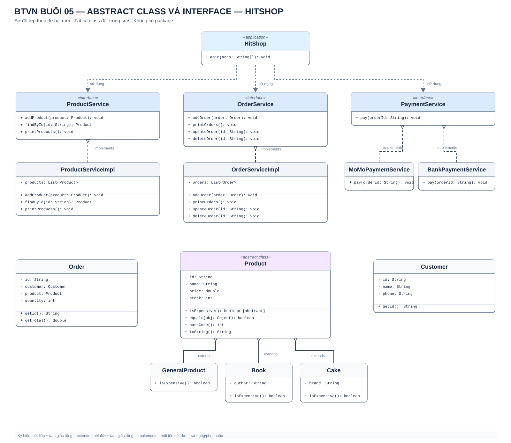

# 🚀 BTVN BUỔI 05: ABSTRACT CLASS VÀ INTERFACE — HITSHOP

## I. Tổng kết buổi trước

Ở buổi 4, chúng ta đã tìm hiểu **kế thừa (Inheritance)** và **đa hình (Polymorphism)** thông qua chương trình **HitShop**.

Chúng ta đã mở rộng `Product` bằng hai class `Book` và `Cake`, sử dụng `extends`, `super()` và `@Override` để xây dựng các loại sản phẩm có cách kiểm tra giá đắt khác nhau.

Chương trình cũng cho phép thêm đơn hàng, xem, sửa, xóa đơn hàng và kiểm tra sản phẩm có đắt hay không.

Tuy nhiên, `HitShop.java` hiện đang đảm nhận nhiều công việc cùng lúc: hiển thị menu, nhập dữ liệu, quản lý danh sách sản phẩm và xử lý đơn hàng. Khi chương trình phát triển thêm, việc đặt toàn bộ logic trong một class sẽ khiến code khó đọc và khó bảo trì.

### Cấu trúc thư mục sau buổi 4

```text
src/
├── HitShop.java
├── Product.java
├── Book.java
├── Cake.java
├── Customer.java
└── Order.java
```

Nếu code hiện tại đang có thư mục `model/`, đưa các class về chung `src/` và bỏ khai báo `package` tương ứng trước khi làm bài. Buổi này chưa chia package; việc tổ chức theo mô hình MVC sẽ được tìm hiểu sau.

## II. Giới thiệu bài tập

Ở buổi 5, chúng ta tiếp tục phát triển HitShop thông qua hai kiến thức mới: **Abstract Class (lớp trừu tượng)** và **Interface (giao diện)**.

Về sản phẩm, mọi loại sản phẩm đều có ID, tên, giá và tồn kho, nhưng cách xác định một sản phẩm có đắt hay không lại khác nhau. Vì vậy, `Product` sẽ trở thành một abstract class, quy định phương thức mà các class con bắt buộc phải triển khai.

Về quản lý cửa hàng, chúng ta sẽ tách các chức năng quản lý sản phẩm và đơn hàng ra khỏi `HitShop`, thông qua hai interface `ProductService` và `OrderService`. Chúng ta cũng bổ sung một interface thanh toán để thấy cách nhiều class triển khai cùng một hợp đồng.

Mục tiêu là **tái sử dụng các chức năng đã làm ở buổi 4**, không xây dựng lại toàn bộ chương trình hay bổ sung nghiệp vụ phức tạp.

## III. Yêu cầu bài tập

### 1. Chuyển `Product.java` thành abstract class

- Thay đổi khai báo `Product` thành `public abstract class Product`.
- Giữ các thuộc tính chung và constructor đã có: `id`, `name`, `price`, `stock`.
- Giữ các getter/setter và phương thức `toString()` từ buổi 4.
- Chuyển phương thức `isExpensive()` thành phương thức trừu tượng:

```java
public abstract boolean isExpensive();
```

**Yêu cầu:** Các class con cụ thể của `Product` phải triển khai `isExpensive()`.

### 2. Tạo class `GeneralProduct.java` và cập nhật các class con

Vì `Product` đã là abstract class nên không thể trực tiếp tạo object bằng `new Product(...)` như ở buổi 4.

Tạo `GeneralProduct`:

- Kế thừa `Product` bằng `extends`.
- Constructor nhận `id`, `name`, `price`, `stock`, sử dụng `super(...)`.
- Override `isExpensive()`: sản phẩm thông thường được coi là đắt khi giá **lớn hơn 10.000**.

Cập nhật `Book` và `Cake`:

- Tiếp tục kế thừa `Product`, giữ thuộc tính riêng `author` hoặc `brand` cùng getter/setter đã làm.
- Giữ constructor gọi `super(...)`.
- Override `isExpensive()` theo các ngưỡng ở buổi 4:
  - `Book`: giá lớn hơn **20.000**.
  - `Cake`: giá lớn hơn **100.000**.

**Yêu cầu:** Các vị trí từng sử dụng `new Product(...)` cho sản phẩm thông thường phải đổi thành `new GeneralProduct(...)`. Tiếp tục sử dụng biến kiểu `Product` để lưu object của `GeneralProduct`, `Book` hoặc `Cake`.

### 3. Tạo interface `ProductService` và `OrderService`

Chương trình cần có hai interface quy định những chức năng quản lý cơ bản.

**`ProductService.java`**

```java
public interface ProductService {
    void addProduct(Product product);
    Product findById(String id);
    void printProducts();
}
```

**`OrderService.java`**

```java
public interface OrderService {
    void addOrder(Order order);
    void printOrders();
    void updateOrder(String id);
    void deleteOrder(String id);
}
```

Ở bước này, các interface **chỉ khai báo chức năng**, chưa viết logic quản lý danh sách.

### 4. Tạo `ProductServiceImpl.java` và `OrderServiceImpl.java`

Tạo hai class triển khai các interface vừa khai báo:

- `ProductServiceImpl implements ProductService`.
- `OrderServiceImpl implements OrderService`.

**Đối với `ProductServiceImpl`:**

- Sử dụng `List<Product>` và `ArrayList<Product>` để lưu sản phẩm.
- `addProduct(...)`: thêm sản phẩm vào danh sách.
- `findById(...)`: trả về sản phẩm có ID tương ứng; nếu không tìm thấy thì trả về `null`.
- `printProducts()`: duyệt và hiển thị các sản phẩm.

**Đối với `OrderServiceImpl`:**

- Sử dụng `List<Order>` và `ArrayList<Order>` để lưu đơn hàng.
- `addOrder(...)`: thêm đơn hàng vào danh sách.
- `printOrders()`: hiển thị danh sách đơn hàng.
- `updateOrder(String id)`: tìm đơn theo ID và cập nhật thông tin.
- `deleteOrder(String id)`: xóa đơn hàng theo ID và thông báo nếu không tìm thấy.

**Yêu cầu:** Tận dụng logic thêm, xem, sửa, xóa đã viết ở buổi 4.

### 5. Tạo interface `PaymentService` và hai hình thức thanh toán

HitShop cần hỗ trợ hai hình thức thanh toán đơn giản: **MoMo** và **HITBank**.

Tạo interface `PaymentService.java` với một phương thức nhận ID đơn hàng:

```java
public interface PaymentService {
    void pay(String orderId);
}
```

Tạo hai class triển khai interface:

- `MoMoPaymentService implements PaymentService`.
- `BankPaymentService implements PaymentService`.

Khi gọi `pay(orderId)`, mỗi class in ra thông báo phù hợp:

- MoMo: `Đơn hàng O01 của bạn đã được thanh toán thành công qua MoMo`.
- HITBank: `Đơn hàng O01 của bạn đã được thanh toán thành công qua HITBank`.

**Yêu cầu:** Sử dụng biến kiểu `PaymentService` để gọi `pay()` với cả hai cách thanh toán. Chức năng chỉ cần in thông báo, chưa cần thay đổi trạng thái đơn hàng.

### 6. Cập nhật `HitShop.java`

`HitShop` tiếp tục chịu trách nhiệm **hiển thị menu và nhận dữ liệu nhập từ bàn phím**. Các thao tác quản lý danh sách được gọi thông qua service thay vì xử lý trực tiếp trong `main`.

Khai báo các service bằng kiểu interface:

```java
ProductService productService = new ProductServiceImpl();
OrderService orderService = new OrderServiceImpl();
```

Với chức năng thanh toán, khai báo biến kiểu `PaymentService` và khởi tạo `MoMoPaymentService` hoặc `BankPaymentService` theo lựa chọn của người dùng.

Giữ nguyên các chức năng menu buổi 4:

```text
===== HITSHOP - QUẢN LÝ ĐƠN HÀNG =====
1. Thêm đơn hàng
2. Xem danh sách đơn hàng
3. Sửa đơn hàng theo ID
4. Xóa đơn hàng theo ID
5. Kiểm tra sản phẩm có đắt không
6. Thanh toán đơn hàng
0. Thoát
```

Khi thực hiện các chức năng:

- `HitShop` tạo object `Customer`, `Product` và `Order` từ dữ liệu người dùng nhập.
- Gọi `productService.addProduct(product)` để lưu sản phẩm vừa tạo, rồi gọi `orderService.addOrder(order)` để lưu đơn hàng.
- Sử dụng `orderService.printOrders()`, `updateOrder(id)` và `deleteOrder(id)` cho các chức năng quản lý đơn hàng.
- Với chức năng kiểm tra giá, gọi `productService.findById(id)` rồi `isExpensive()` trên object `Product` tìm được.
- Với chức năng thanh toán, nhập ID đơn hàng và chọn MoMo hoặc HITBank; sau đó gọi `paymentService.pay(orderId)` để in thông báo.

**Yêu cầu:** Không sử dụng `instanceof` hoặc `if/else` dựa trên loại class để gọi `isExpensive()`. Không tạo các class `Controller`, `Repository` hay cấu trúc MVC trong buổi này.

### 7. Tìm hiểu `equals()` và `hashCode()` của `Product`

Trong Java, mọi class đều kế thừa từ `Object`. Hai phương thức `equals()` và `hashCode()` có thể được override để quy định cách so sánh object.

Tại class `Product`:

- Override `equals(Object obj)` để hai sản phẩm được coi là bằng nhau khi có cùng `id`.
- Override `hashCode()` nhất quán với `equals()`, cũng dựa trên `id`.
- Không cần override lại hai phương thức này trong `GeneralProduct`, `Book`, `Cake`.
- Thực hiện kiểm tra với hai object khác nhau nhưng có cùng ID.

Ví dụ:

```java
Product p1 = new GeneralProduct("P01", "Áo thun", 150000, 20);
Product p2 = new GeneralProduct("P01", "Áo thun mới", 160000, 10);

System.out.println(p1.equals(p2));
System.out.println(p1.hashCode() == p2.hashCode());
```

Kết quả của cả hai câu lệnh là `true`.



## IV. Kết quả mong đợi

Sau khi hoàn thành, HitShop vẫn hoạt động như buổi 4, nhưng các trách nhiệm được phân chia rõ hơn:

| Thành phần | Trách nhiệm |
|---|---|
| `HitShop` | Hiển thị menu, nhập dữ liệu, gọi các service |
| `Product` | Lưu thuộc tính chung, quy định hợp đồng `isExpensive()` |
| `GeneralProduct`, `Book`, `Cake` | Triển khai cách kiểm tra giá đắt của từng loại |
| `ProductService` | Khai báo chức năng quản lý sản phẩm |
| `ProductServiceImpl` | Thực hiện quản lý danh sách sản phẩm |
| `OrderService` | Khai báo chức năng quản lý đơn hàng |
| `OrderServiceImpl` | Thực hiện quản lý danh sách đơn hàng |
| `PaymentService` | Khai báo phương thức thanh toán theo ID đơn hàng |
| `MoMoPaymentService`, `BankPaymentService` | In thông báo thanh toán theo từng hình thức |

### Một số trường hợp cần kiểm tra

| Trường hợp | Kết quả mong đợi |
|---|---|
| Tạo `new Product(...)` | Không biên dịch vì `Product` là abstract class |
| `GeneralProduct` có giá 15.000 | Đắt |
| `Book` có giá 15.000 | Không đắt |
| `Book` có giá 25.000 | Đắt |
| `Cake` có giá 100.000 | Không đắt |
| `Cake` có giá 150.000 | Đắt |
| Thêm, xem, sửa, xóa đơn hàng | Hoạt động như buổi 4 |
| Tìm sản phẩm theo ID không tồn tại | Báo không tìm thấy, không gây lỗi chương trình |
| Hai sản phẩm khác object nhưng cùng ID | `equals()` trả `true`, hash code bằng nhau |
| Thanh toán đơn O01 bằng MoMo | `Đơn hàng O01 của bạn đã được thanh toán thành công qua MoMo` |
| Thanh toán đơn O01 bằng HITBank | `Đơn hàng O01 của bạn đã được thanh toán thành công qua HITBank` |

### Cấu trúc thư mục sau buổi 5

```text
src/
├── HitShop.java
├── Product.java
├── GeneralProduct.java       (Mới)
├── Book.java                 (Cập nhật)
├── Cake.java                 (Cập nhật)
├── Customer.java
├── Order.java
├── ProductService.java       (Mới - Interface)
├── ProductServiceImpl.java   (Mới)
├── OrderService.java         (Mới - Interface)
├── OrderServiceImpl.java     (Mới)
├── PaymentService.java       (Mới - Interface)
├── MoMoPaymentService.java   (Mới)
└── BankPaymentService.java   (Mới)
```

## V. Tổng kết

Sau khi hoàn thành bài tập, học viên cần nắm được:

- **Abstract Class:** Một lớp trừu tượng không được khởi tạo trực tiếp, nhưng có thể chứa thuộc tính, constructor, phương thức thông thường và phương thức trừu tượng.
- **Abstract Method:** Phương thức không có phần thân; các class con cụ thể phải triển khai để có thể được khởi tạo.
- **Interface:** Quy định những chức năng mà class triển khai phải cung cấp.
- **`implements`:** Sử dụng để triển khai interface và tổ chức code theo hợp đồng chung.
- **Phân chia trách nhiệm:** `HitShop` tập trung vào giao diện console; các service quản lý sản phẩm và đơn hàng.
- **Đa hình qua interface:** Cùng lời gọi `pay(orderId)` có thể tạo thông báo thanh toán khác nhau tùy class triển khai.
- **`equals()` và `hashCode()`:** Tìm hiểu cách so sánh object theo dữ liệu thay vì chỉ theo tham chiếu.

### 💡 Một số câu hỏi để suy ngẫm

1. Abstract class và interface khác nhau như thế nào về mục đích sử dụng và khả năng chứa trạng thái, phương thức?
2. Vì sao class cụ thể kế thừa `Product` phải triển khai `isExpensive()`?
3. Vì sao khai báo `ProductService productService = new ProductServiceImpl()` lại có lợi hơn việc để `HitShop` trực tiếp quản lý toàn bộ danh sách sản phẩm?
