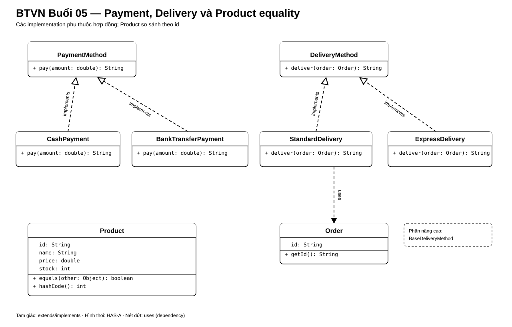

# Bài Tập Về Nhà — Buổi 05

## I. Điểm Bắt Đầu Từ Buổi 04

Giữ Product được bảo vệ trạng thái, Book kế thừa Product, danh sách đa hình và Order chỉ chuyển từ PENDING sang CONFIRMED hoặc CANCELLED.

### 1. Các Ca Cũ Phải Còn Đạt

| Ca | Kết quả cần giữ |
|---|---|
| P01 giảm stock hợp lệ/sai | Chỉ ca hợp lệ làm đổi stock |
| Duyệt P01, P02, P03 qua List<Product> | Gọi đúng getDescription() |
| Confirm rồi cancel O01 | Status vẫn CONFIRMED |

### 2. Cây Thư Mục Đầu Buổi

```text
src/
├── HitShop.java
└── model/
    ├── Product.java
    ├── Book.java
    ├── Customer.java
    ├── CartItem.java
    └── Order.java
```

## II. Bài Bắt Buộc

### 1. PaymentMethod

- Interface `PaymentMethod`: `String pay(double amount)`.
- `CashPayment` trả `Đã nhận tiền mặt: <amount>`.
- `BankTransferPayment` trả `Đã tạo yêu cầu chuyển khoản: <amount>`.
- Method `static void checkout(PaymentMethod method, double amount)` chỉ gọi interface.
- Không dùng `instanceof` hoặc `if/else` theo class payment.

### 2. DeliveryMethod

- Interface `DeliveryMethod`: `String deliver(Order order)`.
- `StandardDelivery` trả `Giao tiêu chuẩn cho đơn <id>`.
- `ExpressDelivery` trả `Giao nhanh cho đơn <id>`.
- Method `static void printDelivery(DeliveryMethod method, Order order)` chỉ gọi interface.

### 3. Equality Của Product

- `Product.equals(Object)` và `hashCode()` cùng dựa duy nhất trên `id`.
- `id` không rỗng, không có setter.
- Product cùng id nhưng khác tên/giá vẫn bằng nhau.
- Kiểm tra `contains()` và `remove()` bằng object khác instance nhưng cùng id.

Dữ liệu chuẩn:

- Order O01 có tổng `350000`.
- P01: `Áo thun / 150000`.
- P01 khác instance: `Áo thun bản cập nhật / 160000`.
- P02: `Bình nước / 50000`.

Object P01 thứ hai chỉ dùng kiểm tra equality; không cập nhật giá catalog trong bài này.



## III. Mở Rộng Tự Chọn

Tạo `abstract class BaseDeliveryMethod` giữ `double fee`, kiểm tra `fee >= 0` và có `double getFee()`.
`StandardDelivery` và `ExpressDelivery` có thể kế thừa class này và vẫn implements `DeliveryMethod`.

Không dùng Optional, generics hoặc lambda trong phần bắt buộc; các nội dung đó thuộc buổi sau.

## IV. Nộp Bài

Nộp source, output payment/delivery và kết quả các ca equality.
Không thay mô hình giỏ hoặc Order của buổi 4.

## V. Nghiệm Thu Buổi 05

### 1. Test Case

| Mã | Thao tác | Kết quả mong đợi |
|---|---|---|
| `TC05-01` | Checkout `350000` bằng Cash | Đúng chuỗi tiền mặt |
| `TC05-02` | Checkout `350000` bằng Bank Transfer | Đúng chuỗi chuyển khoản |
| `TC05-03` | Giao O01 bằng Standard và Express | Đúng hai chuỗi giao hàng |
| `TC05-04` | So sánh hai P01 khác instance | `equals=true`, hash code bằng nhau |
| `TC05-05` | So sánh P01 với P02 và `null` | `false` |
| `TC05-06` | `contains()` bằng P01 khác instance | Tìm thấy |
| `TC05-07` | `remove()` bằng P01 khác instance | Xóa đúng P01 |
| `TC05-08` | Chạy lại Order và danh sách đa hình buổi 4 | Kết quả cũ không đổi |

### 2. Cây Thư Mục Cuối Buổi

```text
src/
├── HitShop.java
├── model/
│   ├── Product.java
│   ├── Book.java
│   ├── Customer.java
│   ├── CartItem.java
│   └── Order.java
├── payment/
│   ├── PaymentMethod.java
│   ├── CashPayment.java
│   └── BankTransferPayment.java
└── delivery/
    ├── DeliveryMethod.java
    ├── StandardDelivery.java
    └── ExpressDelivery.java
```
