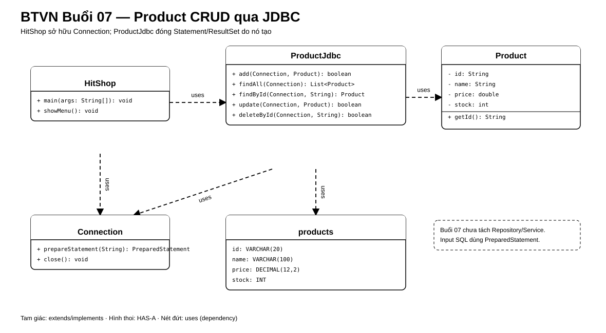

# Bài Tập Về Nhà — Buổi 07

## I. Điểm Bắt Đầu Từ Buổi 06

Giữ model và chức năng cũ.
File `orders.txt` chỉ là bài I/O; Buổi 07 chuyển riêng catalog Product sang MySQL.

### 1. Các Ca Cũ Phải Còn Đạt

| Ca | Kết quả cần giữ |
|---|---|
| Lưu/đọc O01 | File đúng, tổng `350000` |
| Order sai | Không ghi đè file cũ |
| Lỗi I/O | Không báo thành công |

### 2. Cây Thư Mục Đầu Buổi

Dùng nguyên cây cuối [BTVN Buổi 06](../Lesson6/buoi-06-btvn.md), sau đó bổ sung Maven/SQL.

## II. Bài Bắt Buộc

### 1. Maven Và Cấu Hình

- JDK 17, Maven, MySQL Connector/J.
- Database `shop_db`, bảng `products`.
- URL, username, password lấy từ cấu hình cục bộ; không commit credential thật.
- Có `schema.sql`, `seed.sql` và hướng dẫn reset dữ liệu.

### 2. Schema Product

```sql
CREATE TABLE products (
    id VARCHAR(20) PRIMARY KEY,
    name VARCHAR(150) NOT NULL,
    price DECIMAL(12,2) NOT NULL,
    stock INT NOT NULL,
    CHECK (price > 0),
    CHECK (stock >= 0)
);
```

Dữ liệu seed: P01/Áo thun/150000/20, P02/Bình nước/50000/10, P03/Java cơ bản/120000/5.

### 3. ProductJdbc

Tạo các method:

- `boolean add(Connection connection, Product product)`.
- `List<Product> findAll(Connection connection)`.
- `Product findById(Connection connection, String id)`; không có dữ liệu thì trả `null`.
- `boolean update(Connection connection, Product product)`.
- `boolean deleteById(Connection connection, String id)`.

Quy tắc:

- `findAll` dùng Statement với SQL cố định và sắp xếp id tăng dần.
- Mọi SQL nhận input dùng PreparedStatement.
- ProductJdbc đóng Statement/ResultSet do nó tạo, không đóng Connection do caller truyền vào.
- `add/update/delete` chỉ trả thành công khi đúng một row bị tác động.
- Không nối input vào chuỗi SQL.

### 4. Menu

`HitShop` mở/đóng một Connection cho mỗi thao tác:

```text
1. Thêm
2. Liệt kê
3. Tìm theo mã
4. Cập nhật
5. Xóa
0. Thoát
```

Input Product sai bị từ chối trước khi ghi.
Mã không tồn tại báo `Không tìm thấy sản phẩm.`.



## III. Ranh Giới Bài Làm

- Chưa tách Repository/Service; đó là Buổi 08.
- Chưa lưu Order/OrderItem vào database.
- Bảng products chỉ lưu bốn field của Product; chưa lưu riêng author của Book.
- Không dùng JOIN, transaction hoặc ORM.
- Không commit mật khẩu thật.

## IV. Nộp Bài

Nộp source, `pom.xml`, `schema.sql`, `seed.sql` và README cấu hình mẫu.

## V. Nghiệm Thu Buổi 07

### 1. Test Case

| Mã | Thao tác | Kết quả mong đợi |
|---|---|---|
| `TC07-01` | Reset/seed rồi liệt kê | P01, P02, P03 theo id |
| `TC07-02` | Thêm P04/Sổ tay/30000/15 | Thêm đúng một row |
| `TC07-03` | Thêm lại P01 | Bị từ chối, P01 cũ không đổi |
| `TC07-04` | Tìm P01 và P99 | P01 đúng; P99 không tìm thấy |
| `TC07-05` | Cập nhật P04 thành 35000/12 | Đúng một row đổi |
| `TC07-06` | Cập nhật/xóa P99 | Trả thất bại |
| `TC07-07` | Xóa P04 | Trở về ba Product seed |
| `TC07-08` | Nhập id/name rỗng, price <= 0, stock < 0 | Không ghi database |
| `TC07-09` | Kiểm tra source | Input chỉ đi qua PreparedStatement |

### 2. Cây Thư Mục Cuối Buổi

```text
pom.xml
README.md
sql/
├── schema.sql
└── seed.sql
src/main/java/
├── HitShop.java
├── jdbc/
│   └── ProductJdbc.java
└── model/
    ├── Product.java
    ├── Book.java
    ├── Customer.java
    ├── CartItem.java
    └── Order.java
```
