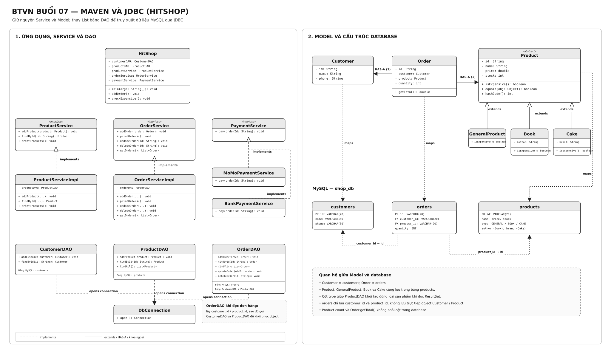

# 🚀 BTVN BUỔI 07: MAVEN VÀ JDBC — HITSHOP

## I. Tổng kết buổi trước

Sau buổi 6, chương trình **HitShop** đã có các chức năng quản lý đơn hàng, kiểm tra giá sản phẩm, thanh toán, xử lý Exception và đọc/ghi file `orders.txt`.

Dữ liệu hiện được lưu trong ba danh sách:

| File | Danh sách |
|---|---|
| `HitShop.java` | `List<Customer> customers` |
| `ProductServiceImpl.java` | `List<Product> products` |
| `OrderServiceImpl.java` | `List<Order> orders` |

### Cấu trúc thư mục sau buổi 6

```text
HitShop/
├── README.md (nếu có)
├── orders.txt
└── src/
    ├── HitShop.java
    ├── Product.java
    ├── GeneralProduct.java
    ├── Book.java
    ├── Cake.java
    ├── Customer.java
    ├── Order.java
    ├── ProductService.java
    ├── ProductServiceImpl.java
    ├── OrderService.java
    ├── OrderServiceImpl.java
    ├── PaymentService.java
    ├── MoMoPaymentService.java
    └── BankPaymentService.java
```

## II. Giới thiệu bài tập

Tiếp tục phát triển **HitShop** từ bài tập buổi 6 với hai công việc:

- Chuyển project Java hiện tại sang Maven.
- Thay thế việc lưu dữ liệu trong các danh sách bằng việc lưu dữ liệu trong MySQL thông qua JDBC.

Giữ nguyên các chức năng, menu, model và tên các phương thức Service của buổi trước. Không bổ sung chức năng quản lý mới.

## III. Yêu cầu bài tập

### 1. Chuyển HitShop sang Maven project

#### 1.1. Thay đổi cấu trúc thư mục

Tại thư mục gốc của project HitShop, tạo hai thư mục `src/main/java` và `src/main/resources`.

Chuyển toàn bộ các file `.java` hiện có trong `src/` vào `src/main/java/`. Giữ nguyên tên file và nội dung các class ở bước này. Giữ `orders.txt` tại thư mục gốc. Nếu đã có `README.md`, giữ nguyên file này.

#### 1.2. Tạo file `pom.xml`

Tạo file `pom.xml` tại thư mục gốc của project với cấu hình Maven cơ bản:

```xml
<project xmlns="http://maven.apache.org/POM/4.0.0"
         xmlns:xsi="http://www.w3.org/2001/XMLSchema-instance"
         xsi:schemaLocation="http://maven.apache.org/POM/4.0.0 https://maven.apache.org/xsd/maven-4.0.0.xsd">
    <modelVersion>4.0.0</modelVersion>

    <groupId>vn.edu.hit</groupId>
    <artifactId>hitshop</artifactId>
    <version>1.0-SNAPSHOT</version>

    <properties>
        <maven.compiler.release>17</maven.compiler.release>
        <project.build.sourceEncoding>UTF-8</project.build.sourceEncoding>
    </properties>

    <dependencies>
    </dependencies>

    <build>
        <plugins>
            <plugin>
                <groupId>org.apache.maven.plugins</groupId>
                <artifactId>maven-compiler-plugin</artifactId>
                <version>3.13.0</version>
            </plugin>
            <plugin>
                <groupId>org.codehaus.mojo</groupId>
                <artifactId>exec-maven-plugin</artifactId>
                <version>3.3.0</version>
                <configuration>
                    <mainClass>HitShop</mainClass>
                </configuration>
            </plugin>
        </plugins>
    </build>
</project>
```

Mở `pom.xml` bằng IntelliJ IDEA dưới dạng Maven project. Phần `<dependencies>` hiện đang để trống; các thư viện cần sử dụng sẽ được bổ sung ở bước tiếp theo.

#### 1.3. Bổ sung dependency cho project

Để kết nối MySQL thông qua JDBC, HitShop cần thư viện **MySQL Connector/J**.

| Dependency | groupId | artifactId | version |
|---|---|---|---|
| MySQL Connector/J | `com.mysql` | `mysql-connector-j` | `8.4.0` |

Mở file `pom.xml` vừa tạo, thêm đoạn khai báo sau vào bên trong cặp thẻ `<dependencies>` và `</dependencies>`:

```xml
<dependency>
    <groupId>com.mysql</groupId>
    <artifactId>mysql-connector-j</artifactId>
    <version>8.4.0</version>
</dependency>
```

- `groupId`: định danh nhóm phát triển thư viện.
- `artifactId`: định danh thư viện cần sử dụng.
- `version`: phiên bản thư viện.

Mỗi thư viện được khai báo bằng một cặp thẻ `<dependency>` riêng bên trong cùng một khối `<dependencies>`. Khi cần thêm thư viện khác, bổ sung một khối `<dependency>` tương ứng, không tạo thêm khối `<dependencies>` mới.

Sau khi thêm dependency, chọn **Reload All Maven Projects** trong cửa sổ Maven của IntelliJ IDEA để Maven tải thư viện. Kiểm tra MySQL Connector/J đã xuất hiện trong **External Libraries**.

#### 1.4. Kiểm tra project

Cấu trúc thư mục sau khi chuyển sang Maven:

```text
HitShop/
├── pom.xml
├── README.md (nếu có)
├── orders.txt
└── src/main/
    ├── java/
    │   ├── HitShop.java
    │   ├── Product.java
    │   ├── GeneralProduct.java
    │   ├── Book.java
    │   ├── Cake.java
    │   ├── Customer.java
    │   ├── Order.java
    │   ├── ProductService.java
    │   ├── ProductServiceImpl.java
    │   ├── OrderService.java
    │   ├── OrderServiceImpl.java
    │   ├── PaymentService.java
    │   ├── MoMoPaymentService.java
    │   └── BankPaymentService.java
    └── resources/
```

Mở terminal tại thư mục gốc của project (thư mục chứa `pom.xml`) và chạy:

```powershell
mvn compile
mvn exec:java
```

**Yêu cầu:** Chương trình chạy được bằng Maven và các chức năng buổi 6 vẫn hoạt động như trước. Sau khi kiểm tra thành công, tiếp tục bài 2.

### 2. Chuyển dữ liệu từ List sang MySQL

#### 2.1. Khởi tạo database và tạo bảng

Đọc các class model trong `src/main/java/` trước khi tạo bảng:

| Class | Thuộc tính trong Java | Cột trong MySQL |
|---|---|---|
| `Customer` | `id`, `name`, `phone` | `id`, `name`, `phone` |
| `Product` | `id`, `name`, `price`, `stock` | `id`, `name`, `price`, `stock` |
| `Book` | `author` và thuộc tính kế thừa | `author` cùng các cột của Product |
| `Cake` | `brand` và thuộc tính kế thừa | `brand` cùng các cột của Product |
| `GeneralProduct` | Các thuộc tính kế thừa từ Product | Các cột của Product |
| `Order` | `id`, `customer`, `product`, `quantity` | `id`, `customer_id`, `product_id`, `quantity` |

`Product` là abstract class. Sử dụng một bảng `products` cho cả ba loại sản phẩm và bổ sung cột `type` để xác định class cần khởi tạo khi đọc dữ liệu. Đây là thông tin phân loại phục vụ lưu trữ, không cần thêm thuộc tính `type` vào model Java.

`Order` chứa object `Customer` và `Product`. Trong database, lưu ID của hai object này để xác định khách hàng và sản phẩm tương ứng. `Product.count` là biến static và `Order.getTotal()` là phương thức tính tổng tiền nên không tạo cột `count` hoặc `total`.

Chạy trực tiếp đoạn SQL sau trong MySQL. Đoạn lệnh tạo database `shop_db` và ba bảng `customers`, `products`, `orders`, đồng thời khai báo khóa chính, khóa ngoại và các ràng buộc dữ liệu.

```sql
CREATE DATABASE IF NOT EXISTS shop_db CHARACTER SET utf8mb4;
USE shop_db;

CREATE TABLE IF NOT EXISTS customers (
    id VARCHAR(20) PRIMARY KEY,
    name VARCHAR(150) NOT NULL,
    phone VARCHAR(30) NOT NULL
);

CREATE TABLE IF NOT EXISTS products (
    id VARCHAR(20) PRIMARY KEY,
    name VARCHAR(150) NOT NULL,
    price DECIMAL(12, 2) NOT NULL CHECK (price > 0),
    stock INT NOT NULL CHECK (stock >= 0),
    type VARCHAR(20) NOT NULL CHECK (type IN ('GENERAL', 'BOOK', 'CAKE')),
    author VARCHAR(150),
    brand VARCHAR(150)
);

CREATE TABLE IF NOT EXISTS orders (
    id VARCHAR(20) PRIMARY KEY,
    customer_id VARCHAR(20) NOT NULL,
    product_id VARCHAR(20) NOT NULL,
    quantity INT NOT NULL CHECK (quantity > 0),
    FOREIGN KEY (customer_id) REFERENCES customers(id),
    FOREIGN KEY (product_id) REFERENCES products(id)
);
```

Thêm dữ liệu mẫu để kiểm thử. Đoạn SQL sau thêm hai khách hàng và hai sản phẩm loại `GENERAL`; bảng `orders` ban đầu để trống. Chỉ chạy một lần nếu các mã này chưa tồn tại.

```sql
USE shop_db;

INSERT INTO customers (id, name, phone) VALUES
('C01', 'Linh Nguyễn', '0900000001'),
('C02', 'An', '0900000002');

INSERT INTO products (id, name, price, stock, type, author, brand) VALUES
('P01', 'Áo thun', 150000, 20, 'GENERAL', NULL, NULL),
('P02', 'Bình nước', 50000, 10, 'GENERAL', NULL, NULL);
```

Có thể dùng các câu lệnh `SELECT` sau để kiểm tra dữ liệu đã được thêm:

```sql
SELECT * FROM customers;
SELECT * FROM products;
SELECT * FROM orders;
```

Không cần tạo file `.sql` trong project.

#### 2.2. Cấu hình kết nối MySQL

Chạy đoạn SQL sau bằng tài khoản quản trị MySQL. Đoạn lệnh tạo tài khoản `java_student` nếu chưa tồn tại và cấp quyền đọc, thêm, sửa, xóa dữ liệu trên database `shop_db`:

```sql
CREATE USER IF NOT EXISTS 'java_student'@'localhost'
IDENTIFIED BY 'JavaDemo_2026!Local';

GRANT SELECT, INSERT, UPDATE, DELETE ON shop_db.*
TO 'java_student'@'localhost';
```

Nếu tài khoản `java_student` đã tồn tại, câu lệnh `CREATE USER IF NOT EXISTS` không đổi mật khẩu; sử dụng mật khẩu hiện tại trong file cấu hình.

Tạo file `src/main/resources/application.properties`:

```properties
db.url=jdbc:mysql://localhost:3306/shop_db
db.username=java_student
db.password=JavaDemo_2026!Local
```

Nếu sử dụng tài khoản hoặc cổng MySQL khác, cập nhật các giá trị tương ứng.

Tạo file `src/main/java/DbConnection.java` theo nội dung đã học ở buổi 7:

```java
import java.io.IOException;
import java.io.InputStream;
import java.sql.Connection;
import java.sql.DriverManager;
import java.sql.SQLException;
import java.util.Properties;

public class DbConnection {
    public static Connection open() throws SQLException {
        Properties config = new Properties();
        try (InputStream input = DbConnection.class.getResourceAsStream(
                "/application.properties")) {
            if (input == null) {
                throw new SQLException("Không tìm thấy application.properties");
            }
            config.load(input);
        } catch (IOException e) {
            throw new SQLException("Không đọc được file cấu hình", e);
        }

        return DriverManager.getConnection(
                config.getProperty("db.url"),
                config.getProperty("db.username"),
                config.getProperty("db.password"));
    }
}
```

`DbConnection.open()` được sử dụng chung trong các class DAO để mở kết nối tới database.

#### 2.3. Tạo các class DAO

DAO (Data Access Object) là class chịu trách nhiệm đọc và ghi dữ liệu của một model trong database.

Tạo ba file mới tại `src/main/java/`:

- `CustomerDAO.java`: làm việc với bảng `customers`.
- `ProductDAO.java`: làm việc với bảng `products`.
- `OrderDAO.java`: làm việc với bảng `orders`.

Mỗi class chỉ cung cấp các thao tác truy xuất dữ liệu cần cho những chức năng đã có. Không đưa `Scanner`, menu, thông báo giao diện hoặc logic thanh toán vào DAO.

**`CustomerDAO.java`**

```text
public void addCustomer(Customer customer) throws SQLException
public Customer findById(String id) throws SQLException
```

| Phương thức | Yêu cầu |
|---|---|
| `addCustomer` | INSERT `id`, `name`, `phone` từ object Customer |
| `findById` | SELECT theo `id`, đọc ResultSet và tạo object Customer; trả `null` nếu không tồn tại |

**`ProductDAO.java`**

```text
public void addProduct(Product product) throws SQLException
public Product findById(String id) throws SQLException
public List<Product> findAll() throws SQLException
```

| Phương thức | Yêu cầu |
|---|---|
| `addProduct` | INSERT các thuộc tính sản phẩm và thông tin loại |
| `findById` | SELECT theo `id` và trả về Product; trả `null` nếu không tồn tại |
| `findAll` | SELECT toàn bộ sản phẩm theo `id` tăng dần và trả về `List<Product>` |

Khi ghi sản phẩm, xác định loại object bằng `instanceof`: `Book` lưu thêm `author`, `Cake` lưu thêm `brand`, `GeneralProduct` không có hai thuộc tính này. Cột không áp dụng lưu SQL `NULL`.

Khi đọc ResultSet, dựa vào cột `type` để sử dụng constructor tương ứng:

```text
GENERAL → GeneralProduct(id, name, price, stock)
BOOK    → Book(id, name, price, stock, author)
CAKE    → Cake(id, name, price, stock, brand)
```

Nhờ đó, chức năng `isExpensive()` vẫn thực hiện đúng theo từng class.

**`OrderDAO.java`**

```text
public void addOrder(Order order) throws SQLException
public Order findById(String id) throws SQLException
public List<Order> findAll() throws SQLException
public void updateOrder(String oldId, Order order) throws SQLException
public void deleteOrder(String id) throws SQLException
```

| Phương thức | Yêu cầu |
|---|---|
| `addOrder` | INSERT mã đơn hàng, mã khách hàng, mã sản phẩm và số lượng |
| `findById` | SELECT đơn hàng theo mã; trả `null` nếu không tồn tại |
| `findAll` | SELECT toàn bộ đơn hàng theo mã tăng dần |
| `updateOrder` | UPDATE bốn cột của đơn hàng theo mã cũ (`WHERE id = ?`) |
| `deleteOrder` | DELETE đơn hàng theo mã |

Khi đọc đơn hàng, lấy `customer_id` và `product_id` từ ResultSet, gọi `CustomerDAO.findById()` và `ProductDAO.findById()` để lấy hai object tương ứng, sau đó tạo `new Order(id, customer, product, quantity)`. `OrderDAO` chỉ trực tiếp gửi SQL tới bảng `orders`; việc đọc hai bảng còn lại do DAO tương ứng thực hiện.

Tham số `oldId` trong `updateOrder()` dùng để tìm dòng cần UPDATE khi người dùng chọn sửa ID đơn hàng. Nếu dùng ID mới trong điều kiện `WHERE`, có thể không tìm thấy dòng cũ.

**Yêu cầu chung:**

- Mở kết nối bằng `DbConnection.open()`, sử dụng `try-with-resources` để đóng `Connection`, `Statement`, `PreparedStatement` và `ResultSet`.
- Dùng `Statement` khi đọc toàn bộ danh sách bằng SQL cố định. Dùng `PreparedStatement` khi câu SQL nhận giá trị từ object hoặc người dùng.
- Dùng `executeQuery()` và `ResultSet` để đọc dữ liệu; dùng `executeUpdate()` để thêm, sửa, xóa. Kiểm tra số dòng bị tác động. Với UPDATE, giữ nguyên dữ liệu cũng là một thao tác hợp lệ nếu đơn hàng tồn tại; với DELETE, kết quả 0 dòng nghĩa là không tìm thấy đơn hàng và cần throw Exception.
- Các DAO khai báo `throws SQLException` để chuyển lỗi JDBC tới nơi gọi. Giữ Exception kiểm tra dữ liệu của các model.

#### 2.4. Cập nhật `ProductServiceImpl.java`

Bỏ thuộc tính đang lưu danh sách sản phẩm:

```java
private List<Product> products = new ArrayList<>();
```

Thay bằng:

```java
private ProductDAO productDAO = new ProductDAO();
```

Giữ nguyên tên và tham số của các method đã có. Sửa phần thân method như sau:

| Method hiện tại | Logic cần thay đổi |
|---|---|
| `addProduct(Product product)` | Giữ kiểm tra dữ liệu; thay `products.add(product)` bằng `productDAO.addProduct(product)` |
| `findById(String id)` | Bỏ vòng lặp tìm trong list; gọi `productDAO.findById(id)`. Nếu trả `null`, throw Exception không tìm thấy như buổi 6 |
| `printProducts()` | Lấy danh sách bằng `productDAO.findAll()`, giữ phần kiểm tra rỗng và vòng lặp in sản phẩm |

Ví dụ, method `findById()` sau khi cập nhật:

```java
@Override
public Product findById(String id) throws SQLException {
    Product product = productDAO.findById(id);
    if (product == null) {
        throw new IllegalArgumentException("Không tìm thấy sản phẩm!");
    }
    return product;
}
```

Thêm `import java.sql.SQLException;` và khai báo `throws SQLException` cho ba method tương ứng trong `ProductService.java` và `ProductServiceImpl.java`.

#### 2.5. Cập nhật `OrderServiceImpl.java`

Bỏ thuộc tính:

```java
private List<Order> orders = new ArrayList<>();
```

Thay bằng:

```java
private OrderDAO orderDAO = new OrderDAO();
```

| Method hiện tại | Logic cần thay đổi |
|---|---|
| `addOrder(Order order)` | Giữ kiểm tra dữ liệu, thay `orders.add(order)` bằng `orderDAO.addOrder(order)` |
| `printOrders()` | Lấy danh sách bằng `orderDAO.findAll()`, giữ phần in danh sách cũ |
| `updateOrder(String id)` | Gọi `orderDAO.findById(id)`, kiểm tra tồn tại, gọi `HitShop.updateOrderDetails(order)` như trước, sau đó gọi `orderDAO.updateOrder(id, order)` |
| `deleteOrder(String id)` | Bỏ vòng lặp tìm và xóa phần tử; gọi `orderDAO.deleteOrder(id)`, báo thành công sau khi DAO thực hiện thành công |
| `getOrders()` | Trả về `orderDAO.findAll()` để chức năng ghi file lấy dữ liệu từ database |

Thêm `import java.sql.SQLException;` và `throws SQLException` vào các method tương ứng của `OrderService.java` và `OrderServiceImpl.java`.

#### 2.6. Cập nhật `HitShop.java`

**Khai báo dữ liệu và hàm `main()`**

Thay `public static List<Customer> customers = new ArrayList<>();` bằng:

```java
public static CustomerDAO customerDAO = new CustomerDAO();
public static ProductDAO productDAO = new ProductDAO();
```

Giữ hai biến `productService` và `orderService` hiện có.

Bỏ bốn lệnh thêm dữ liệu mẫu (hai Customer và hai Product) trong `main()`, vì dữ liệu mẫu đã được thêm bằng các câu lệnh SQL ở bước 2.1.

**Method `addOrder()` — lựa chọn 1**

Giữ cách nhập thông tin khách hàng, sản phẩm và số lượng của buổi 6. Sau khi nhập:

- Dùng `customerDAO.findById()` và `productDAO.findById()` để kiểm tra mã đã tồn tại. Nếu mã đã có, sử dụng object đọc từ database cho đơn hàng, không INSERT trùng ID. Nếu chưa có, sử dụng object vừa nhập. Thông báo khi dùng lại dữ liệu đã lưu.
- Tạo `Order` với các object đã xác định và số lượng nhập vào để kiểm tra dữ liệu như buổi 6.
- Thay `customers.add(customer)` bằng `customerDAO.addCustomer(customer)` nếu khách hàng chưa tồn tại; gọi `productService.addProduct(product)` nếu sản phẩm chưa tồn tại.
- Gọi `orderService.addOrder(order)` sau khi khách hàng và sản phẩm đã có trong database. Bỏ các lệnh thêm danh sách cũ. Chỉ in thông báo thành công sau khi lưu được đơn hàng.

**Method `updateOrderDetails(Order orderUpdate)` — lựa chọn 3**

- Mục 1 (sửa ID) và mục 4 (sửa số lượng): giữ cách nhập và gọi setter như buổi 6.
- Mục 2 (sửa Customer) và mục 3 (sửa Product): giữ cách nhập thông tin, kiểm tra mã và sử dụng dữ liệu đã lưu nếu tồn tại giống `addOrder()`. Nếu là mã mới, kiểm tra hợp lệ rồi lưu bằng DAO/Service tương ứng trước khi đơn hàng được UPDATE.
- Giữ các setter để kiểm tra dữ liệu. Bỏ thông báo `Sửa đơn hàng thành công!` ở cuối method này và chuyển sang `OrderServiceImpl.updateOrder()` sau khi DAO đã UPDATE thành công.

**Các method còn lại**

| Method | Yêu cầu |
|---|---|
| `checkExpensive()` | Giữ lời gọi `productService.findById(id)` và `product.isExpensive()`; Service đã chuyển sang MySQL |
| `updateOrder()`, `deleteOrder()` | Giữ lời gọi `orderService.updateOrder(id)` và `orderService.deleteOrder(id)` |
| `saveOrders()` | Giữ định dạng file; lấy danh sách từ `orderService.getOrders()` trước khi mở file ghi, để lỗi SQL không làm mất nội dung file cũ |
| `readOrders()`, `payOrder()` | Giữ nguyên |

Bổ sung `throws SQLException` cho các method gọi DAO/Service nếu cần chuyển lỗi tới `main()`. Bổ sung `catch (SQLException e)` cho các lựa chọn `1`, `2`, `3`, `4`, `5`, `7` có truy cập database. Giữ xử lý Exception dữ liệu và IOException của buổi 6. Khi có lỗi, in thông báo phù hợp và tiếp tục hiển thị menu.

**Yêu cầu:** giữ nguyên menu 0–8. Không thêm chức năng, không thay đổi cách gọi `isExpensive()` hay các model. `List` vẫn được sử dụng để chứa kết quả đọc từ database, nhưng không còn là nơi lưu trữ dữ liệu chính. Không yêu cầu JOIN hoặc transaction trong bài này; các bản ghi khách hàng/sản phẩm đã thêm thành công có thể còn lại nếu thao tác ghi đơn hàng sau đó thất bại.

## IV. Kết quả mong đợi

### Các trường hợp cần kiểm tra

| Mã | Thao tác | Kết quả mong đợi |
|---|---|---|
| `TC07-01` | Chạy HitShop bằng Maven sau bài 1 | Menu và các chức năng buổi 6 hoạt động |
| `TC07-02` | Tạo O01 với C01, P01 và số lượng 2 | Bảng `orders` có O01, tổng tiền hiển thị 300000; không trùng dữ liệu mẫu |
| `TC07-03` | Tạo đơn với khách hàng mới và sản phẩm Book mới, tên có dấu nháy đơn | Dữ liệu được lưu đúng vào ba bảng; tác giả được lưu đầy đủ |
| `TC07-04` | Thoát và chạy lại, chọn 2 | Hiển thị các đơn đã lưu, không chèn lại dữ liệu mẫu |
| `TC07-05` | Tạo đơn hàng với Cake mới, kiểm tra giá của Book và Cake đã lưu, kể cả sau khi chạy lại | Áp dụng đúng ngưỡng giá của từng loại sản phẩm |
| `TC07-06` | Sửa mã O01 thành O03, sửa số lượng hợp lệ | Dòng cũ được cập nhật; không tạo thêm đơn hàng |
| `TC07-07` | Sửa khách hàng hoặc sản phẩm của đơn hàng | Mã tham chiếu trong `orders` cập nhật đúng |
| `TC07-08` | Xóa đơn hàng theo mã | Dòng đơn hàng bị xóa khỏi database; khách hàng và sản phẩm vẫn tồn tại |
| `TC07-09` | Tìm sản phẩm hoặc sửa/xóa đơn không tồn tại, nhập dữ liệu không hợp lệ | Hiển thị lỗi, không báo thành công; menu tiếp tục hoạt động |
| `TC07-10` | Chọn 7 rồi 8 | File chứa đúng danh sách đơn hàng trong MySQL |
| `TC07-11` | Dừng MySQL rồi chọn 2 hoặc 7 | Báo lỗi SQL, không thoát chương trình và không ghi đè file cũ |
| `TC07-12` | Thanh toán bằng MoMo hoặc HITBank | Hoạt động như buổi 6 |

### Cấu trúc thư mục sau buổi 7

```text
HitShop/
├── pom.xml                          (Mới)
├── README.md                       (Tạo hoặc cập nhật)
├── orders.txt
└── src/main/
    ├── resources/
    │   └── application.properties   (Mới)
    └── java/
        ├── HitShop.java             (Cập nhật)
        ├── DbConnection.java        (Mới)
        ├── CustomerDAO.java         (Mới)
        ├── ProductDAO.java          (Mới)
        ├── OrderDAO.java            (Mới)
        ├── Product.java
        ├── GeneralProduct.java
        ├── Book.java
        ├── Cake.java
        ├── Customer.java
        ├── Order.java
        ├── ProductService.java      (Cập nhật)
        ├── ProductServiceImpl.java  (Cập nhật)
        ├── OrderService.java        (Cập nhật)
        ├── OrderServiceImpl.java    (Cập nhật)
        ├── PaymentService.java
        ├── MoMoPaymentService.java
        └── BankPaymentService.java
```



## V. Nộp bài

- Source code HitShop sau khi cập nhật, `pom.xml` và `application.properties` với thông tin kết nối.
- README nêu các câu lệnh SQL dùng để tạo database, bảng, dữ liệu mẫu và tài khoản kết nối; hướng dẫn chạy project bằng Maven.
- File `orders.txt` và kết quả chạy các trường hợp kiểm tra tại mục IV.
