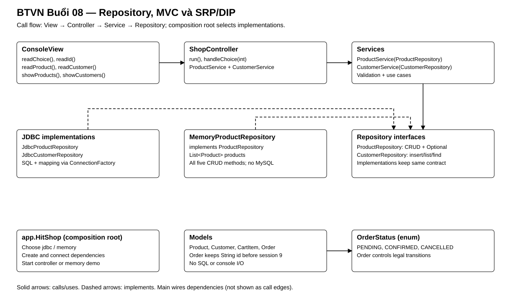

# Bài Tập Về Nhà — Buổi 08: Tách Tầng, MVC Và Refactor

## I. Tổng Kết Bài Tập Về Nhà Buổi 07

Sau bài tập buổi 7, project đã chuyển catalog Product sang MySQL và hoàn thành CRUD qua JDBC.

### 1. Các Test Case Phải Chạy Được

| Mã | Thao tác | Kết quả mong đợi |
|---|---|---|
| `TC07-01` | Liệt kê dữ liệu seed | Có đúng P01, P02, P03 theo thứ tự id |
| `TC07-02` | Thêm P04 hợp lệ rồi thêm lại mã P01 | P04 được thêm; mã trùng bị từ chối |
| `TC07-03` | Tìm P01 và P99 | P01 trả đúng dữ liệu; P99 báo không tìm thấy |
| `TC07-04` | Cập nhật name/price/stock của P04 | Đúng một row thay đổi, id không đổi |
| `TC07-05` | Xóa P04 rồi xóa P99 | P04 bị xóa; P99 báo không tìm thấy |
| `TC07-06` | Nhập dữ liệu vi phạm ràng buộc | Bị từ chối trước khi ghi database |

### 2. Cây Thư Mục Sau Buổi 07

Cấu trúc source tối thiểu liên quan trực tiếp đến phần JDBC:

```text
pom.xml
README.md
sql/
├── schema.sql
└── seed.sql
src/main/java/
├── HitShop.java
├── jdbc/ProductJdbc.java
└── model/
    ├── Product.java
    ├── Book.java
    ├── Customer.java
    ├── CartItem.java
    └── Order.java
```

## II. Bài Bắt Buộc — Repository, Service, MVC Và Trạng Thái Đơn

### 1. Kế Thừa Từ Buổi 07

Tiếp tục `HitShop` bằng JDK 17, bảng `products` và JDBC CRUD đã có. Gộp yêu cầu buổi 8 và buổi 10 cũ trong một lần refactor: đưa SQL vào repository, validation vào service, tách View/Controller và lắp dependency tại main. Giữ dữ liệu và hành vi JDBC của buổi 7. Chưa lưu Order nhiều bảng; phần đó tiếp tục ở buổi 9.

### 2. Luồng Bắt Buộc

```text
ConsoleView → ShopController → ProductService hoặc CustomerService → repository interface → JDBC implementation → MySQL
```

- Model giữ dữ liệu/hành vi; không đọc bàn phím, in menu hoặc chứa SQL.
- ConsoleView chỉ nhập/hiển thị, không gọi Service/Repository/JDBC.
- ShopController điều phối từ View sang Service; không chứa SQL hoặc tự kiểm tra quy tắc nghiệp vụ.
- Service nhận repository interface qua constructor và không chứa SQL.
- JDBC implementation chứa SQL/mapping, không đọc bàn phím hoặc in menu.
- `app.HitShop.main` là composition root: tạo connection provider, repository, service, view và controller rồi gọi `controller.run()`.

SRP được thể hiện qua trách nhiệm từng class; DIP được thể hiện qua Service phụ thuộc repository interface.

### 3. Thành Phần Và Hợp Đồng

- `ProductRepository`:
  - `boolean insert(Product product)`;
  - `List<Product> findAll()`;
  - `Optional<Product> findById(String id)`;
  - `boolean update(Product product)`;
  - `boolean deleteById(String id)`.
- `JdbcProductRepository` implements `ProductRepository` và chuyển SQL CRUD buổi 7 vào đây.
- `ProductService` nhận `ProductRepository` qua constructor; có `addProduct`, `findAllProducts`, `findProductById`, `updateProduct`, `deleteProduct` với kiểu trả về tương ứng repository.
- Service từ chối Product có id/name rỗng, giá không dương hoặc stock âm trước khi gọi repository.
- Tạo bảng `customers(id VARCHAR(20) PRIMARY KEY, name VARCHAR(100) NOT NULL, phone VARCHAR(20) NOT NULL)`.
- `CustomerRepository` có `insert`, `findAll`, `findById`; `JdbcCustomerRepository` triển khai ba method.
- `CustomerService` nhận `CustomerRepository` qua constructor, kiểm tra id/name/phone không rỗng rồi mới thêm; cung cấp `addCustomer`, `findAllCustomers`, `findCustomerById`.
- `findById` và method tìm tương ứng của service trả `Optional.empty()` khi không có dữ liệu; không trả null.
- Tạo enum `OrderStatus { PENDING, CONFIRMED, CANCELLED }` và đổi field status của Order từ String sang enum; `getStatus()` đổi kiểu trả về thành `OrderStatus`. Các chuyển trạng thái của buổi 4 phải tiếp tục đúng.

### 4. Controller, View Và Hợp Đồng Service

Các method interface dưới đây là public; method class khai báo public. Giữ nguyên các model và constructor/getter/setter đã có.

- `ProductService`: `boolean addProduct(Product product)`, `List<Product> findAllProducts()`, `Optional<Product> findProductById(String id)`, `boolean updateProduct(Product product)`, `boolean deleteProduct(String id)`.
- `CustomerRepository`: `boolean insert(Customer customer)`, `List<Customer> findAll()`, `Optional<Customer> findById(String id)`.
- `CustomerService`: `boolean addCustomer(Customer customer)`, `List<Customer> findAllCustomers()`, `Optional<Customer> findCustomerById(String id)`.
- `ConsoleView`: `void showMenu()`, `int readChoice()`, `Product readProduct()`, `Customer readCustomer()`, `String readId()`, `void showMessage(String message)`, `void showProducts(List<Product> products)`, `void showCustomers(List<Customer> customers)`.
- `ShopController`: constructor nhận View, ProductService, CustomerService; `public void run()` lặp menu đến lựa chọn thoát; `public void handleChoice(int choice)` điều phối thêm/xem/tìm/sửa/xóa Product, thêm/xem/tìm Customer.
- `ConsoleView.readProduct()` và `readCustomer()` chỉ đóng gói dữ liệu được nhập; Service kiểm tra hợp lệ. Model hiện có vẫn giữ invariant riêng nếu đã quy định từ các buổi trước.
- Giữ các chức năng thanh toán, giỏ hàng và Order trong bộ nhớ; không đổi mã Order từ String sang long trước buổi 9.

### 5. Memory Repository Và Nghiệm Thu Refactor

Tạo `MemoryProductRepository implements ProductRepository`, field `List<Product> products`, constructor nhận `List<Product>` dữ liệu ban đầu và triển khai đủ năm method của ProductRepository. So sánh theo id; trùng mã hoặc sửa/xóa mã không tồn tại trả false; `findAll()` trả bản sao danh sách.

Tại composition root, chọn JDBC hoặc memory bằng tham số chạy `jdbc`/`memory` (mặc định `jdbc`). Nhánh memory chỉ cần demo tìm/liệt kê Product, không mở kết nối MySQL và không khởi tạo Customer flow. Hai chế độ phải dùng cùng class ProductService.

1. Ghi kết quả CRUD trước refactor bằng dữ liệu chuẩn buổi 7.
2. Tách repository/service rồi View/Controller theo từng commit nhỏ.
3. Chạy lại cùng dữ liệu sau mỗi bước, giữ nguyên kết quả nghiệp vụ.
4. Chạy memory với P01/P02 và chứng minh không phải sửa ProductService.
5. Kiểm tra SQL chỉ nằm trong JDBC repository; View không gọi Service/Repository, Controller không tự tính nghiệp vụ.

### 6. Sơ Đồ Lớp Và Quan Hệ



View trao đổi với Controller; Controller gọi Service; Service nhận repository interface qua constructor; lớp JDBC và memory implements cùng interface. `Order` dùng `OrderStatus` thay cho chuỗi trạng thái.

### 7. Dữ Liệu Nghiệm Thu

- Product: P01, P02, P03 như các buổi trước.
- Customer: `C01 / Linh Nguyễn / 0900000001`, `C02 / Minh Trần / 0900000002`.
- Tìm P01 trả đúng Product và tìm C01 trả đúng Customer. Tìm P99 hoặc C99 trả `Optional.empty()`; console hiển thị thông báo không tìm thấy.
- Product có giá 0 hoặc Customer có số điện thoại rỗng bị service từ chối và không được ghi vào database.
- Order mới có status `PENDING`; xác nhận thành `CONFIRMED`; không thể hủy lại order đã xác nhận.

### 8. Nộp Bài

Nộp schema customers, source theo package, enum, output trước/sau refactor và bằng chứng chạy JDBC/memory. README mô tả cấu hình database, hai tham số chạy, một luồng View → Controller → Service → Repository và vị trí áp dụng SRP/DIP. Không commit credential database.

## III. Mở Rộng — Bài Tự Chọn

- Tạo `PaymentMethodFactory` nhận `CASH`/`BANK` và trả implementation tương ứng.
- Tạo record `ProductSummary(String id, String name, double price)` và method chuyển một `Product` thành `ProductSummary` để hiển thị.
- Viết unit test service bằng một repository in-memory.
- Chuẩn hóa lỗi nghiệp vụ bằng custom exception.

## IV. Tổng Kết Bài Tập Về Nhà Buổi 08

Sau bài tập buổi 8, View → Controller → Service → Repository interface → JDBC implementation là luồng chính; main lắp dependency; cùng ProductService chạy được với memory; trạng thái Order dùng enum.

### 1. Các Test Case Phải Chạy Được

| Mã | Thao tác | Kết quả mong đợi |
|---|---|---|
| `TC08-01` | Chạy lại CRUD Product qua console | Kết quả giống buổi 7 nhưng console đi qua Controller và `ProductService` |
| `TC08-02` | Tìm P01 rồi P99 | Trả `Optional` có P01; P99 là `Optional.empty()` và console báo không tìm thấy |
| `TC08-03` | Thêm Product có giá `0` hoặc stock âm | Service từ chối trước khi repository được gọi |
| `TC08-04` | Thêm C01, C02 rồi liệt kê | Database có đúng hai Customer chuẩn |
| `TC08-05` | Tìm C01 rồi C99 | C01 trả đúng Customer; C99 là `Optional.empty()` |
| `TC08-06` | Thêm Customer có phone rỗng | Service từ chối và database không đổi |
| `TC08-07` | Tạo Order mới, gọi `confirm()` rồi `cancel()` | Trạng thái đi từ `PENDING` sang `CONFIRMED` và không thể hủy lại |
| `TC08-08` | Tìm toàn source theo chuỗi SQL | SQL chỉ nằm trong các JDBC repository, không nằm trong console hoặc service |
| `TC08-09` | Kiểm tra lời gọi View/Controller | View không gọi Service/Repository; Controller chỉ điều phối |
| `TC08-10` | Chạy chế độ memory với P01/P02 | Tìm/liệt kê đúng, không cần MySQL và không sửa ProductService |
| `TC08-11` | Kiểm tra main | Chỉ chọn implementation, lắp dependency và khởi động luồng tương ứng |
| `TC08-12` | So sánh CRUD trước/sau refactor | Dữ liệu và kết quả nghiệp vụ giữ nguyên |

### 2. Cây Thư Mục Sau Buổi 08

Cấu trúc source tối thiểu của phần bắt buộc; các package cũ vẫn được giữ nếu còn được sử dụng:

```text
pom.xml
README.md
sql/
├── schema.sql
└── seed.sql
src/main/java/
├── app/HitShop.java
├── controller/ShopController.java
├── view/ConsoleView.java
├── config/
│   └── ConnectionFactory.java
├── model/
│   ├── Product.java
│   ├── Customer.java
│   ├── CartItem.java
│   ├── Order.java
│   └── OrderStatus.java
├── repository/
│   ├── ProductRepository.java
│   ├── CustomerRepository.java
│   ├── MemoryProductRepository.java
│   └── jdbc/
│       ├── JdbcProductRepository.java
│       └── JdbcCustomerRepository.java
└── service/
    ├── ProductService.java
    └── CustomerService.java
```
