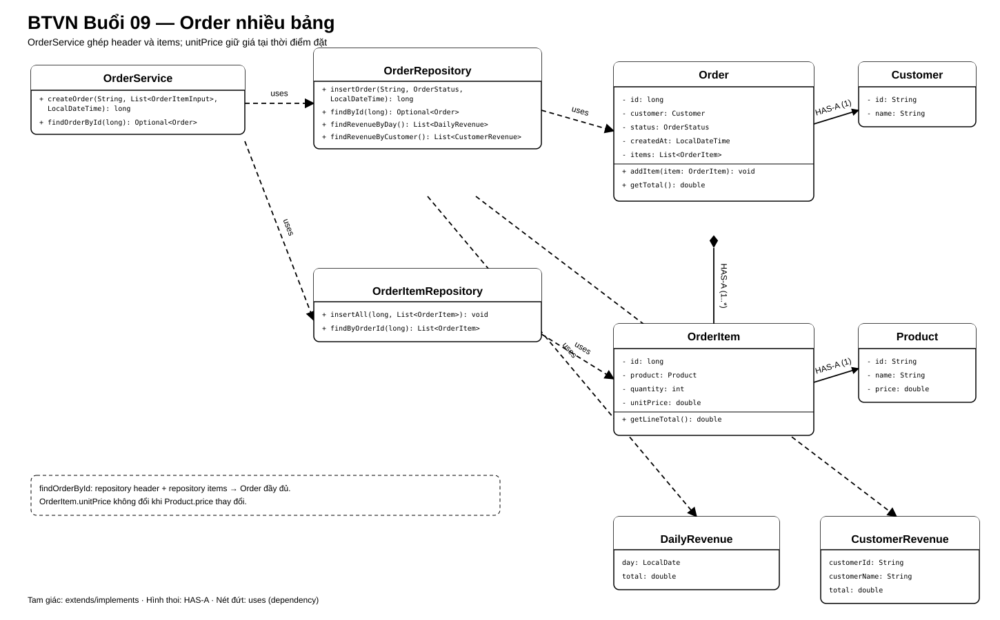

# Bài Tập Về Nhà — Buổi 09

## I. Tổng Kết Bài Tập Về Nhà Buổi 08

Sau bài tập buổi 8, project đã tách luồng View → Controller → Service → Repository interface → JDBC implementation, dùng `Optional` cho kết quả tìm kiếm và `OrderStatus` cho trạng thái đơn.

### 1. Các Test Case Phải Chạy Được

| Mã | Thao tác | Kết quả mong đợi |
|---|---|---|
| `TC08-01` | Chạy CRUD Product qua Controller/ProductService | Kết quả giữ nguyên như buổi 7 |
| `TC08-02` | Tìm P01 rồi P99 | P01 trả đúng dữ liệu; P99 là Optional.empty() |
| `TC08-05` | Tìm C01 rồi C99 | C01 trả đúng dữ liệu; C99 là Optional.empty() |
| `TC08-07` | Xác nhận Order rồi thử hủy | Trạng thái CONFIRMED không đổi |
| `TC08-09` | Kiểm tra View/Controller | View không gọi Service/Repository; Controller chỉ điều phối |
| `TC08-10` | Chạy ProductService với memory | Tìm/liệt kê P01/P02 không cần MySQL |
| `TC08-11` | Kiểm tra main | Lắp dependency tại composition root |

### 2. Cây Thư Mục Sau Buổi 08

Cấu trúc source tối thiểu của phần bắt buộc; các package cũ vẫn được giữ nếu còn được sử dụng:

```text
pom.xml
README.md
sql/
├── schema.sql
└── seed.sql
src/main/java/
├── app/HitShop.java
├── controller/ShopController.java
├── view/ConsoleView.java
├── config/ConnectionFactory.java
├── model/
│   ├── Product.java
│   ├── Customer.java
│   ├── CartItem.java
│   ├── Order.java
│   └── OrderStatus.java
├── repository/
│   ├── ProductRepository.java
│   ├── CustomerRepository.java
│   ├── MemoryProductRepository.java
│   └── jdbc/
│       ├── JdbcProductRepository.java
│       └── JdbcCustomerRepository.java
└── service/
    ├── ProductService.java
    └── CustomerService.java
```

## II. Bài Bắt Buộc — Đơn Hàng Nhiều Bảng, JOIN Và Báo Cáo

### 1. Mốc Chuyển Mô Hình

Tiếp tục repository `HitShop` bằng JDK 17 và database buổi 8. Từ buổi này, Order được lưu trong MySQL và `orders.id` là `BIGINT AUTO_INCREMENT`; mã chuỗi `O01` của giai đoạn file được thay bằng id số như `1`. Không duy trì đồng thời hai kiểu id trong model Order.

### 2. Schema Bắt Buộc

```sql
CREATE TABLE orders (
    id BIGINT PRIMARY KEY AUTO_INCREMENT,
    customer_id VARCHAR(20) NOT NULL,
    status VARCHAR(20) NOT NULL,
    created_at DATETIME NOT NULL,
    FOREIGN KEY (customer_id) REFERENCES customers(id)
);

CREATE TABLE order_items (
    id BIGINT PRIMARY KEY AUTO_INCREMENT,
    order_id BIGINT NOT NULL,
    product_id VARCHAR(20) NOT NULL,
    quantity INT NOT NULL,
    unit_price DECIMAL(12,2) NOT NULL,
    FOREIGN KEY (order_id) REFERENCES orders(id),
    FOREIGN KEY (product_id) REFERENCES products(id)
);
```

`quantity > 0`; `unit_price > 0`. `unit_price` là giá chốt khi mua, không đọc lại giá hiện tại để tính lịch sử đơn.

### 3. Model Và Hợp Đồng Repository

- `Order`: `long id`, `Customer customer`, `OrderStatus status`, `LocalDateTime createdAt`, `List<OrderItem> items`; `addItem(OrderItem)` thêm một dòng và `getTotal()` cộng các line total.
- `OrderItem`: `long id`, `Product product`, `int quantity`, `double unitPrice`; `getLineTotal()` trả `quantity * unitPrice`.
- `OrderRepository.insertOrder(String customerId, OrderStatus status, LocalDateTime createdAt): long` dùng generated key.
- `OrderRepository.findById(long id): Optional<Order>` nạp phần header và Customer, khởi tạo items rỗng.
- `OrderItemRepository.insertAll(long orderId, List<OrderItem> items): void`.
- `OrderItemRepository.findByOrderId(long orderId): List<OrderItem>` JOIN Product để tạo từng OrderItem.
- Tạo record `OrderItemInput(String productId, int quantity)` trong package `dto`. `ConsoleView.readOrderItems(): List<OrderItemInput>` chỉ thu productId/quantity; không tra Product hoặc nhận unitPrice.
- `OrderService.createOrder(String customerId, List<OrderItemInput> inputs, LocalDateTime createdAt): long` tra Customer/Product qua repository, kiểm tra dữ liệu rồi tạo OrderItem với giá hiện tại. Nhận generated id của Order và truyền cho `OrderItemRepository.insertAll`.
- `ShopController` nhận input từ View và gọi Service; thêm `ConsoleView.readCustomerId(): String`, `readCreatedAt(): LocalDateTime` và method hiển thị đơn/báo cáo. Main nối thêm OrderService/repository vào kiến trúc buổi 8.
- Không giữ thêm overload `createOrder` nhận `List<OrderItem>` vì trùng chữ ký sau type erasure với `List<OrderItemInput>`.
- `OrderService.findOrderById(long id): Optional<Order>` gọi cả hai repository và gắn danh sách item trước khi trả kết quả. View không tự ghép dữ liệu.
- `OrderRepository.findRevenueByDay(): List<DailyRevenue>`.
- `OrderRepository.findRevenueByCustomer(): List<CustomerRevenue>`.

Các method của class ở hợp đồng trên là public; constructor nhận dependency cần dùng. `findOrderById` trả Optional như buổi 8, không đổi thành Order trực tiếp.

### 4. Sơ Đồ Lớp Và Quan Hệ



`OrderService` ghép phần header từ `OrderRepository` với các dòng từ `OrderItemRepository`; `Order` chứa nhiều `OrderItem`, và mỗi dòng giữ một `Product` cùng `unitPrice` đã chốt.

### 5. Hành Vi Bắt Buộc

- Service từ chối customer không tồn tại, danh sách item rỗng, quantity không dương hoặc product không tồn tại.
- Tạo Order trước OrderItem và dùng đúng khóa tự tăng vừa nhận; không đoán id bằng `MAX(id)`.
- SQL nhận input dùng `PreparedStatement`.
- Xem đơn in id, Customer, thời gian, trạng thái, từng dòng hàng và tổng.
- Báo cáo ngày sắp xếp ngày tăng dần; báo cáo khách sắp xếp customer id tăng dần. Tổng là `SUM(quantity * unit_price)`.

### 6. Dữ Liệu Chuẩn

- Customers: C01/Linh Nguyễn, C02/Minh Trần.
- Product hiện tại: P01 giá 160000, P02 giá 50000.
- Order id 1: C01, `2026-01-15 10:00`, CONFIRMED; P01 × 2 với `unit_price=150000`, P02 × 1 với `unit_price=50000`; tổng `350000`.
- Order id 2: C02, `2026-01-15 11:00`, CONFIRMED; P02 × 3 với `unit_price=50000`; tổng `150000`.
- Báo cáo ngày `2026-01-15` là `500000`; C01 `350000`, C02 `150000`.
- Order 1 vẫn hiển thị giá P01 là 150000 dù catalog hiện tại là 160000.

### 7. Nộp Bài

Nộp schema, seed, source repository/service và output tạo đơn, xem chi tiết, hai báo cáo. README ghi rõ bước reset database để id bắt đầu từ 1.

## III. Nâng Cao — Transaction Và Tối Ưu

- Đặt insert Order và toàn bộ OrderItem trong cùng transaction; cố ý làm một item lỗi để chứng minh không còn Order mồ côi.
- Batch insert OrderItem.
- Phân trang danh sách Order bằng `LIMIT/OFFSET`.
- Tách `OrderItemRowMapper` dùng chung cho các truy vấn item.

## IV. Tổng Kết Bài Tập Về Nhà Buổi 09

Sau bài tập buổi 9, Order dùng khóa số do MySQL sinh, OrderItem giữ giá lịch sử và Service ghép dữ liệu từ nhiều repository trước khi trả cho View.

### 1. Các Test Case Phải Chạy Được

Reset database để Order đầu tiên có id `1` trước khi chạy bộ test.

| Mã | Thao tác | Kết quả mong đợi |
|---|---|---|
| `TC09-01` | Tạo Order cho C01 với `P01 × 2`, `P02 × 1` | Nhận generated id `1`; header và hai item được lưu đúng khóa ngoại |
| `TC09-02` | Tạo Order với customer không tồn tại, item rỗng, product sai hoặc quantity không dương | Service từ chối trước khi hoàn tất nghiệp vụ |
| `TC09-03` | Xem Order id `1` | Hiển thị C01, thời gian, trạng thái, hai item và tổng `350000` |
| `TC09-04` | Đổi giá hiện tại của P01 từ `150000` thành `160000`, xem lại Order 1 | Order vẫn dùng `unit_price=150000` và tổng vẫn là `350000` |
| `TC09-05` | Tạo Order 2 cho C02 với `P02 × 3` | Tổng Order 2 bằng `150000` |
| `TC09-06` | Chạy báo cáo ngày `2026-01-15` | Doanh thu ngày bằng `500000` |
| `TC09-07` | Chạy báo cáo theo Customer | C01 bằng `350000`, C02 bằng `150000`, sắp xếp theo id tăng dần |
| `TC09-08` | Kiểm tra code tạo Order | Dùng generated key của lệnh INSERT, không dùng `MAX(id)` |
| `TC09-09` | Nhập productId/quantity qua console | View tạo OrderItemInput; Service tra Product và chốt giá, không lấy unitPrice từ người dùng |
| `TC09-10` | Chạy lại Product/Customer sau khi thêm Order | Luồng View → Controller → Service → Repository vẫn đúng, không có SQL ngoài JDBC repository |

### 2. Cây Thư Mục Sau Buổi 09

Cấu trúc source tối thiểu của phần bắt buộc; các package cũ vẫn được giữ nếu còn được sử dụng:

```text
pom.xml
README.md
sql/
├── schema.sql
└── seed.sql
src/main/java/
├── app/HitShop.java
├── controller/ShopController.java
├── view/ConsoleView.java
├── config/ConnectionFactory.java
├── dto/
│   ├── OrderItemInput.java
│   ├── DailyRevenue.java
│   └── CustomerRevenue.java
├── model/
│   ├── Product.java
│   ├── Customer.java
│   ├── Order.java
│   ├── OrderItem.java
│   └── OrderStatus.java
├── repository/
│   ├── ProductRepository.java
│   ├── CustomerRepository.java
│   ├── MemoryProductRepository.java
│   ├── OrderRepository.java
│   ├── OrderItemRepository.java
│   └── jdbc/
│       ├── JdbcProductRepository.java
│       ├── JdbcCustomerRepository.java
│       ├── JdbcOrderRepository.java
│       └── JdbcOrderItemRepository.java
└── service/
    ├── ProductService.java
    ├── CustomerService.java
    └── OrderService.java
```
