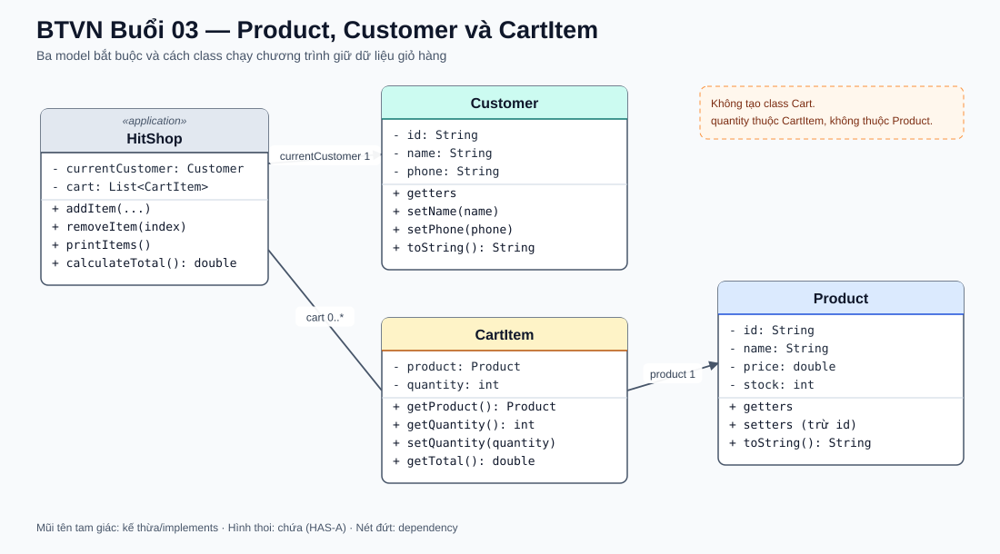

# Bài Tập Về Nhà — Buổi 03

## Bài Bắt Buộc — Mô Hình Hóa Mặt Hàng Và Giỏ Hàng Bằng Object

### Kế Thừa Từ Buổi 02

Tiếp tục `HitShop.java`, menu và dữ liệu giỏ của repository cũ bằng JDK 17. Ở buổi này, bổ sung mã `P01`, `P02` khi tạo Product. Không tạo app mới. Bốn method `addItem`, `removeItem`, `printItems`, `calculateTotal` vẫn giữ tên; tham số và dữ liệu bên trong đổi từ ba list song song sang `Product`/`CartItem`.

### Bài Toán

Thay dữ liệu rời của giỏ hàng buổi 2 bằng các object có trách nhiệm riêng. Chương trình vẫn chạy trên console; phạm vi là một danh sách sản phẩm có sẵn và một giỏ hàng của một khách hàng.

### Các Class Và Quan Hệ Bắt Buộc

- `Product`: field `id`, `name`, `price`, `stock`, đều private. Constructor nhận đủ bốn giá trị. Có getter cho cả bốn field; chỉ `name`, `price`, `stock` có setter. `toString()` trả dạng `P01 | Áo thun | 150000.0 | tồn: 20`.
- `Customer`: field `id`, `name`, `phone`, đều private. Constructor nhận đủ ba giá trị; có getter cho cả ba và setter cho `name`, `phone`. `toString()` trả dạng `C01 | Linh Nguyễn | 0900000001`.
- `CartItem`: field `product` kiểu `Product` và `quantity` kiểu `int`, đều private. Constructor nhận hai giá trị; có `getProduct()`, `getQuantity()`, `setQuantity(int quantity)` và `getTotal()` trả `product.getPrice() × quantity`.
- Quan hệ: `CartItem` HAS-A `Product`; giỏ hàng là `List<CartItem>`. Chương trình giữ đúng một biến `currentCustomer` kiểu Customer và một list giỏ hàng; không tạo class Cart hoặc lưu số lượng mua trong Product.
- Tạo package `model` cho ba class trên. Class chạy chương trình nằm ngoài package model và sử dụng các object thông qua public constructor/method.
- Tên class chạy chương trình vẫn là `HitShop`; giỏ được giữ trong một `List<CartItem>`.

### Sơ Đồ Lớp Và Quan Hệ

Hình thoi tại `HitShop` thể hiện chương trình giữ nhiều `CartItem`; mỗi `CartItem` tham chiếu đúng một `Product`. Không tạo thêm class `Cart`.

### Dữ Liệu Chuẩn Và Kết Quả

- Product: `P01 / Áo thun / 150000 / 20`; `P02 / Bình nước / 50000 / 10`.
- Customer: `C01 / Linh Nguyễn / 0900000001`.
- Giỏ mẫu: `P01 × 2`, `P02 × 1`. Khi in giỏ, mỗi dòng phải có mã/tên sản phẩm, số lượng và thành tiền; tổng giỏ là `350000`.
- Một `CartItem` chỉ chứa đúng một `Product` và một số lượng. Khi thay đổi quantity của CartItem, stock của Product không tự đổi.
- Nộp toàn bộ source theo đúng package; không dùng database, kế thừa, interface hoặc ID tự tăng trong phần bắt buộc.

### Nộp Bài

Nộp source của `HitShop` và ba class model; kèm output giỏ chuẩn có tổng `350000`.

## Mốc Bàn Giao Cho Buổi 04

Giữ ba model, giỏ hàng, menu và bốn method giỏ hàng. Buổi 4 mở rộng Product bằng lớp con và thêm Order; các chức năng thêm/xóa/in/tính tổng hiện có vẫn phải chạy.

## Nâng Cao — Bài Tự Chọn

- `Product` có thể có `static` ID tuần tự và getter tĩnh `getCount()`. Hai sản phẩm được tạo ngoài dữ liệu mẫu phải nhận các ID tiếp theo theo thứ tự tạo. Phần này không thay thế được mã nhập thủ công trong bài lõi.
- Phần access modifier: ghi nhận class/field/method nào truy cập được trong cùng package và từ package khác; không thay đổi các field private bắt buộc của model.

Các phần nâng cao không ảnh hưởng khả năng chạy giỏ hàng core nếu không làm.
