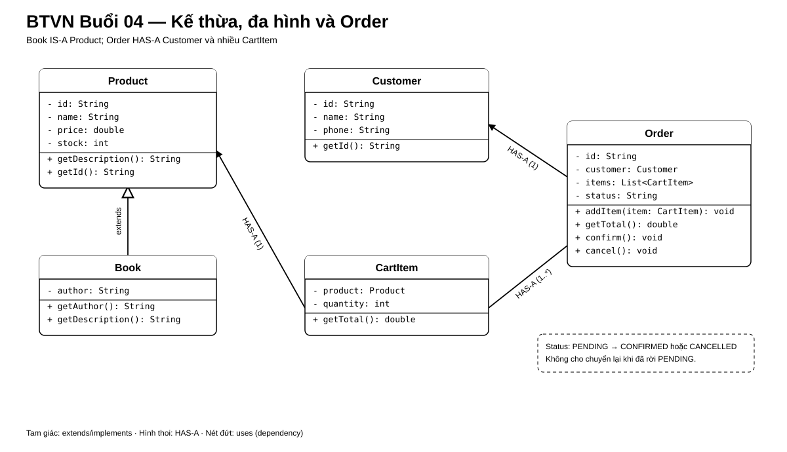

# Bài Tập Về Nhà — Buổi 04

## Bài Bắt Buộc — Kế Thừa, Đa Hình Và Trạng Thái Đơn

### Kế Thừa Từ Buổi 03

Tiếp tục repository `HitShop` bằng JDK 17 và các class `Product`, `Customer`, `CartItem`. Giữ sản phẩm P01/P02, khách C01, giỏ P01 × 2 và P02 × 1. `HitShop` tiếp tục cung cấp các chức năng `addItem`, `removeItem`, `printItems`, `calculateTotal`, đồng thời bổ sung `Book` và `Order`.

### Bài Toán

Mở rộng mô hình `Product`, `Customer`, `CartItem` từ buổi 3 để biểu diễn một loại sản phẩm chuyên biệt và một đơn hàng. Ví dụ dùng sách; mọi dữ liệu hiển thị phải đến từ method của object phù hợp, không rẽ nhánh theo tên loại sản phẩm.

### Class, Field Và Quan Hệ

- `Product` giữ `id`, `name`, `price`, `stock` và có method `getDescription()` trả về tên sản phẩm. Các field tiếp tục private; không truy cập trực tiếp từ lớp con.
- `Book extends Product`, có field private `author` và `getAuthor()`. Constructor nhận `id`, `name`, `price`, `stock`, `author`; khởi tạo phần Product cùng dữ liệu đó. Override `getDescription()` trả về đúng mẫu `Tên sách — tác giả: Tên tác giả`.
- Một `List<Product>` chứa cả object Product thường và Book. Phần hiển thị danh sách gọi cùng `getDescription()` cho mọi phần tử.
- `Order` có các field private: `id`, `customer` kiểu `Customer`, `items` kiểu `List<CartItem>` và `status` kiểu `String`. Constructor nhận `id` và `customer`; trạng thái ban đầu là `PENDING`. Order HAS-A Customer và HAS-A nhiều CartItem; mỗi CartItem vẫn HAS-A một Product.
- `Order.addItem(CartItem item)` thêm một dòng và `getTotal()` trả tổng các giá trị `CartItem.getTotal()`. `confirm()` chuyển `PENDING` thành `CONFIRMED`; `cancel()` chuyển `PENDING` thành `CANCELLED`. Khi trạng thái không còn là `PENDING`, `confirm()` và `cancel()` không thay đổi trạng thái.
- Các chữ ký là `void addItem(CartItem item)`, `double getTotal()`, `void confirm()`, `void cancel()`, `String getStatus()`, `String getId()`, `Customer getCustomer()` và `List<CartItem> getItems()`. `getItems()` không được trả null.
- Tên class chạy chương trình vẫn là `HitShop`; giữ menu console và các luồng giỏ hàng đã có ở buổi 2–3, đồng thời bổ sung hiển thị danh sách đa hình và thao tác với Order.

### Sơ Đồ Lớp Và Quan Hệ

Mũi tên tam giác biểu diễn `Book extends Product`; hình thoi tại `Order` biểu diễn một đơn chứa nhiều `CartItem`.

### Nộp Bài

Nộp source các model và `HitShop`; kèm output danh sách mô tả, menu/giỏ hàng đang có, tổng đơn và trạng thái sau xác nhận.

### Dữ Liệu Chuẩn Và Kết Quả

- Product thường tiếp tục từ buổi 3: `P01 / Áo thun / 150000 / stock 20`; `P02 / Bình nước / 50000 / stock 10`.
- Book mới: `P03 / Java cơ bản / 120000 / stock 5 / An Nguyen`.
- List hiển thị ba mô tả: `Áo thun`, `Bình nước` và `Java cơ bản — tác giả: An Nguyen`.
- Customer `C01 / Linh Nguyễn / 0900000001`; Order `O01` tiếp nhận giỏ đã xây dựng ở buổi trước, gồm `P01 × 2` và `P02 × 1`; tổng đơn là `350000`.
- Trước xác nhận, status là `PENDING`; sau `confirm()`, status là `CONFIRMED`. Lời gọi `cancel()` tiếp theo không đổi status.
- Một Order khác ở trạng thái `PENDING`, khi gọi `cancel()`, chuyển thành `CANCELLED`; gọi lại `cancel()` không đổi trạng thái.

## Nâng Cao — Bài Tự Chọn

- Mô tả sự khác nhau giữa overloading và overriding.
- Xác định quan hệ Book–Product là IS-A và Order–CartItem là HAS-A.
- Viết hai overload: `findProducts(String keyword)` trả mọi sản phẩm có tên chứa từ khóa; `findProducts(String keyword, int limit)` trả tối đa `limit` kết quả đầu tiên.
- Lọc các đối tượng `Book` trong `List<Product>` và lấy tên tác giả từ từng đối tượng `Book`.
