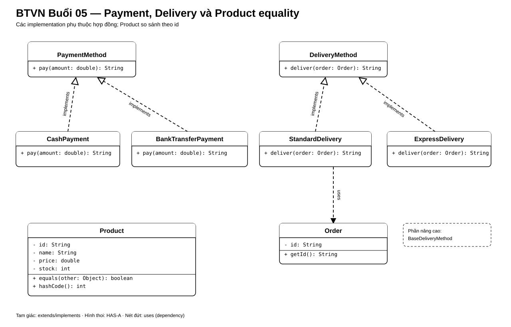

# Bài Tập Về Nhà — Buổi 05

## Bài Bắt Buộc — Thanh Toán, Giao Hàng Và Equality Của Product

### Kế Thừa Từ Buổi 04

Tiếp tục repository `HitShop` bằng JDK 17. Giữ Product P01/P02/P03, Customer C01 và Order O01 có tổng `350000`. Bài này bổ sung các cách thanh toán, giao hàng và quy tắc so sánh Product; không thay mô hình giỏ hoặc đơn.

### 1. Hợp Đồng Thanh Toán

- Tạo interface `PaymentMethod` với method `String pay(double amount)`.
- `CashPayment` và `BankTransferPayment` đều triển khai `PaymentMethod`.
- `CashPayment.pay(350000)` trả `Đã nhận tiền mặt: 350000.0`.
- `BankTransferPayment.pay(350000)` trả `Đã tạo yêu cầu chuyển khoản: 350000.0`.
- Nơi gọi chỉ giữ biến kiểu `PaymentMethod` và gọi `pay`; không dùng `if/else` để kiểm tra class cụ thể.

### 2. Hợp Đồng Giao Hàng

- Tạo interface `DeliveryMethod` với method `String deliver(Order order)`.
- `StandardDelivery` trả `Giao tiêu chuẩn cho đơn O01` khi nhận Order O01.
- `ExpressDelivery` trả `Giao nhanh cho đơn O01` khi nhận Order O01.
- Viết method `printDelivery(DeliveryMethod method, Order order)` để chứng minh hai implementation có thể thay thế nhau mà nơi gọi không đổi.

### 3. Equality Của Product

- Override `equals(Object)` và `hashCode()` của Product dựa duy nhất trên `id`.
- `id` không được null hoặc rỗng và không có setter.
- Hai object Product cùng id nhưng khác tên hoặc giá vẫn được xem là bằng nhau và có cùng hash code.
- Dùng `ArrayList<Product>` để kiểm tra `contains` và `remove` bằng một object khác instance nhưng cùng id.

### Sơ Đồ Lớp Và Quan Hệ

Các lớp thanh toán và giao hàng phụ thuộc vào interface tương ứng; nơi gọi chỉ làm việc qua interface, không kiểm tra implementation cụ thể.

### Dữ Liệu Nghiệm Thu

- `P01 / Áo thun / 150000` và `P01 / Áo thun bản cập nhật / 160000` bằng nhau.
- `P02 / Bình nước / 50000` không bằng P01.
- `CashPayment` và `BankTransferPayment` trả đúng chuỗi chuẩn khi nhận amount `350000.0`.
- `StandardDelivery` và `ExpressDelivery` trả đúng chuỗi chuẩn khi nhận Order O01.
- Xóa một Product P01 bằng object khác instance nhưng cùng id phải loại đúng P01 khỏi danh sách.

### Nộp Bài

Nộp source của hai interface, bốn implementation, Product đã cập nhật và `HitShop`; kèm output nghiệm thu.

## Mở Rộng — Bài Tự Chọn

- Tạo abstract class `BaseDeliveryMethod` giữ `fee`, kiểm tra `fee >= 0` và cung cấp `getFee()`; hai delivery kế thừa class này đồng thời implements `DeliveryMethod`.
- Viết `findProductById` trả `Optional<Product>`.
- Tạo generic class `Box<T>` giữ một giá trị và trả lại đúng kiểu qua `getValue()`.
