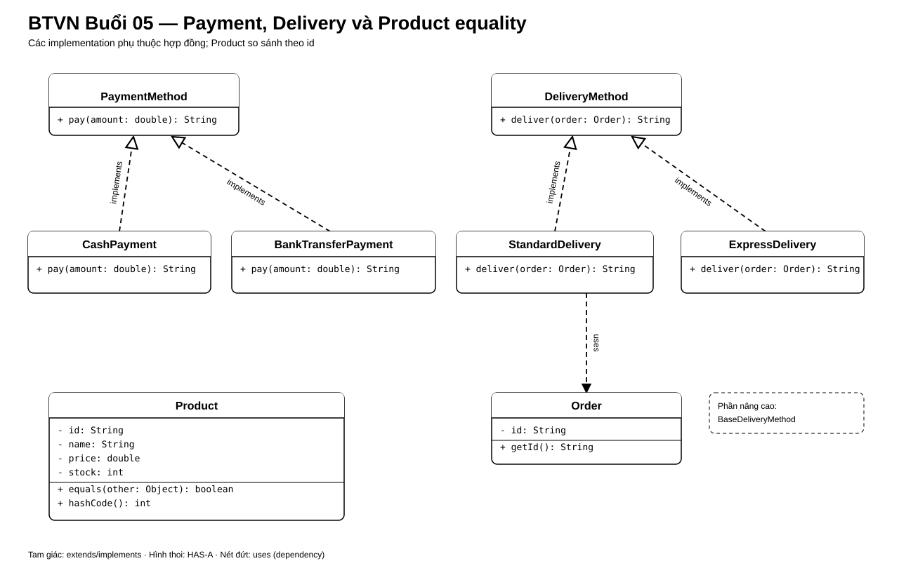

# Bài Tập Về Nhà — Buổi 05

## I. Tổng Kết Bài Tập Về Nhà Buổi 04

Sau bài tập buổi 4, project đã có kế thừa `Book extends Product`, hiển thị đa hình và model `Order` giữ Customer, nhiều CartItem cùng trạng thái được kiểm soát.

### 1. Các Test Case Phải Chạy Được

| Mã | Thao tác | Kết quả mong đợi |
|---|---|---|
| `TC04-01` | Gọi `getDescription()` trên P01, P02 và Book P03 qua `List<Product>` | Mỗi object trả đúng mô tả; Book có thêm tác giả |
| `TC04-02` | Tạo O01 với `P01 × 2`, `P02 × 1` | Tổng đơn bằng `350000` |
| `TC04-03` | Xác nhận O01 đang `PENDING`, sau đó thử hủy | Trạng thái là `CONFIRMED` và không đổi sau lời gọi hủy |
| `TC04-04` | Hủy một Order mới đang `PENDING` | Trạng thái chuyển thành `CANCELLED` |
| `TC04-05` | Gọi lại `confirm()` hoặc `cancel()` trên Order không còn `PENDING` | Trạng thái giữ nguyên |

### 2. Cây Thư Mục Sau Buổi 04

Cấu trúc source tối thiểu cần đạt:

```text
src/
├── HitShop.java
└── model/
    ├── Product.java
    ├── Book.java
    ├── Customer.java
    ├── CartItem.java
    └── Order.java
```

## II. Bài Bắt Buộc — Thanh Toán, Giao Hàng Và Equality Của Product

### 1. Kế Thừa Từ Buổi 04

Tiếp tục repository `HitShop` bằng JDK 17. Giữ Product P01/P02/P03, Customer C01 và Order O01 có tổng `350000`. Bài này bổ sung các cách thanh toán, giao hàng và quy tắc so sánh Product; không thay mô hình giỏ hoặc đơn.

### 2. Hợp Đồng Thanh Toán

- Tạo interface `PaymentMethod` với method `String pay(double amount)`.
- `CashPayment` và `BankTransferPayment` đều triển khai `PaymentMethod`.
- `CashPayment.pay(350000)` trả `Đã nhận tiền mặt: 350000.0`.
- `BankTransferPayment.pay(350000)` trả `Đã tạo yêu cầu chuyển khoản: 350000.0`.
- Nơi gọi chỉ giữ biến kiểu `PaymentMethod` và gọi `pay`; không dùng `if/else` để kiểm tra class cụ thể.

### 3. Hợp Đồng Giao Hàng

- Tạo interface `DeliveryMethod` với method `String deliver(Order order)`.
- `StandardDelivery` trả `Giao tiêu chuẩn cho đơn O01` khi nhận Order O01.
- `ExpressDelivery` trả `Giao nhanh cho đơn O01` khi nhận Order O01.
- Viết method `printDelivery(DeliveryMethod method, Order order)` để chứng minh hai implementation có thể thay thế nhau mà nơi gọi không đổi.

### 4. Equality Của Product

- Override `equals(Object)` và `hashCode()` của Product dựa duy nhất trên `id`.
- `id` không được null hoặc rỗng và không có setter.
- Hai object Product cùng id nhưng khác tên hoặc giá vẫn được xem là bằng nhau và có cùng hash code.
- Dùng `ArrayList<Product>` để kiểm tra `contains` và `remove` bằng một object khác instance nhưng cùng id.

### 5. Sơ Đồ Lớp Và Quan Hệ



Các lớp thanh toán và giao hàng phụ thuộc vào interface tương ứng; nơi gọi chỉ làm việc qua interface, không kiểm tra implementation cụ thể.

### 6. Dữ Liệu Nghiệm Thu

- `P01 / Áo thun / 150000` và `P01 / Áo thun bản cập nhật / 160000` bằng nhau.
- `P02 / Bình nước / 50000` không bằng P01.
- `CashPayment` và `BankTransferPayment` trả đúng chuỗi chuẩn khi nhận amount `350000.0`.
- `StandardDelivery` và `ExpressDelivery` trả đúng chuỗi chuẩn khi nhận Order O01.
- Xóa một Product P01 bằng object khác instance nhưng cùng id phải loại đúng P01 khỏi danh sách.

### 7. Nộp Bài

Nộp source của hai interface, bốn implementation, Product đã cập nhật và `HitShop`; kèm output nghiệm thu.

## III. Mở Rộng — Bài Tự Chọn

- Tạo abstract class `BaseDeliveryMethod` giữ `fee`, kiểm tra `fee >= 0` và cung cấp `getFee()`; hai delivery kế thừa class này đồng thời implements `DeliveryMethod`.
- Viết `findProductById` trả `Optional<Product>`.
- Tạo generic class `Box<T>` giữ một giá trị và trả lại đúng kiểu qua `getValue()`.

## IV. Tổng Kết Bài Tập Về Nhà Buổi 05

Sau bài tập buổi 5, nơi sử dụng thanh toán và giao hàng phụ thuộc interface; Product được so sánh theo định danh `id` thay vì địa chỉ object.

### 1. Các Test Case Phải Chạy Được

| Mã | Thao tác | Kết quả mong đợi |
|---|---|---|
| `TC05-01` | Gọi `pay(350000)` qua biến `PaymentMethod` lần lượt với Cash và Bank Transfer | Trả đúng hai chuỗi thanh toán chuẩn mà nơi gọi không đổi |
| `TC05-02` | Gọi `printDelivery(...)` với Standard và Express cho O01 | Trả đúng `Giao tiêu chuẩn cho đơn O01` và `Giao nhanh cho đơn O01` |
| `TC05-03` | So sánh hai Product khác instance nhưng cùng id P01 | `equals()` trả `true` và hai hash code bằng nhau |
| `TC05-04` | So sánh P01 với P02 hoặc với `null` | `equals()` trả `false` |
| `TC05-05` | Gọi `contains()` bằng object P01 khác instance | Danh sách tìm thấy P01 |
| `TC05-06` | Gọi `remove()` bằng object P01 khác instance | Đúng Product P01 bị xóa khỏi danh sách |

### 2. Cây Thư Mục Sau Buổi 05

Cấu trúc source tối thiểu cần đạt:

```text
src/
├── HitShop.java
├── model/
│   ├── Product.java
│   ├── Book.java
│   ├── Customer.java
│   ├── CartItem.java
│   └── Order.java
├── payment/
│   ├── PaymentMethod.java
│   ├── CashPayment.java
│   └── BankTransferPayment.java
└── delivery/
    ├── DeliveryMethod.java
    ├── StandardDelivery.java
    └── ExpressDelivery.java
```
