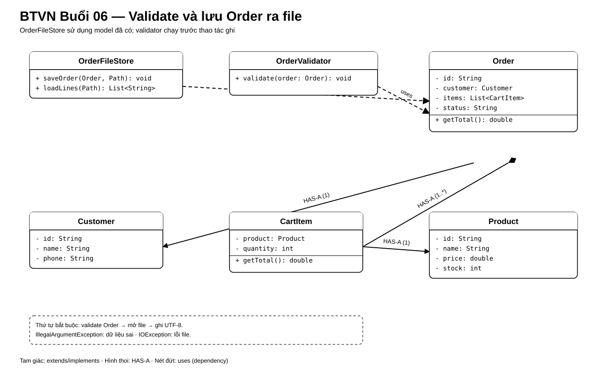

# Bài Tập Về Nhà — Buổi 06

## Bài Bắt Buộc — Kiểm Tra Dữ Liệu Và Lưu Đơn Hàng Ra File

### Kế Thừa Từ Buổi 05

Tiếp tục `HitShop` bằng JDK 17 và dùng nguyên các model Product, Customer, CartItem, Order. Order vẫn được tạo bằng `new Order(id, customer)` rồi thêm item qua `addItem`; không tạo constructor hoặc một model Order khác chỉ để đọc file.

### Bài Toán

Kiểm tra một Order trước khi lưu, ghi nội dung dễ đọc vào `orders.txt`, sau đó đọc lại các dòng để hiển thị.

### Định Dạng File

Mỗi đơn là một khối:

```text
ORDER|O01|C01|Linh Nguyễn|PENDING
ITEM|P01|Áo thun|2|150000.0
ITEM|P02|Bình nước|1|50000.0
END
```

- `ORDER` giữ order id, customer id, customer name và status.
- Mỗi `ITEM` giữ product id, product name, quantity và unit price tại lúc lưu.
- `END` kết thúc một đơn.
- Dữ liệu chuẩn không chứa ký tự `|`.

### Class Và Hành Vi Bắt Buộc

- Tạo `OrderValidator.validate(Order order)`; ném `IllegalArgumentException` nếu `order` là null, danh sách item rỗng, hoặc có `CartItem` chứa Product null hay quantity không dương.
- Tạo `OrderFileStore` với:
  - `void saveOrder(Order order, Path path) throws IOException`;
  - `List<String> loadLines(Path path) throws IOException`.
- `saveOrder` gọi validator trước khi mở file, dùng UTF-8 và ghi lại một khối đơn theo đúng định dạng trên. Bài chỉ lưu một đơn nên có thể ghi đè file cũ.
- Dùng `Files.newBufferedWriter`/`Files.newBufferedReader` trong try-with-resources. Không tự gọi `close()` trong nhiều nhánh.
- Nếu file chưa tồn tại, `loadLines` trả danh sách rỗng và thông báo `Chưa có dữ liệu đơn hàng.`.
- Nếu lưu thất bại, không in thông báo thành công. Thông báo lỗi phải nêu thao tác nào thất bại nhưng không in mật khẩu hay thông tin nhạy cảm.
- Khi đọc, in lần lượt các dòng của file và tính lại tổng từ các dòng `ITEM`.

### Sơ Đồ Lớp Và Quan Hệ



`OrderFileStore` dùng `OrderValidator` trước khi ghi một `Order`; `loadLines` đọc file và trả về các dòng văn bản. Không tạo thêm một model Order dành riêng cho file.

### Dữ Liệu Nghiệm Thu

Order O01 của C01 gồm P01 × 2 giá 150000 và P02 × 1 giá 50000, trạng thái PENDING. File phải có đúng khối mẫu; tổng đọc lại là `350000.0`.

Kiểm tra thêm ba trường hợp:

1. Order không có item: báo lỗi hợp lệ và file không bị ghi.
2. Một CartItem có quantity 0: báo lỗi hợp lệ và file không bị ghi.
3. Đường dẫn không ghi được: báo lỗi I/O, không báo `Lưu thành công`.

### Nộp Bài

Nộp source, file `orders.txt` mẫu và output của bốn ca kiểm tra.

## Mở Rộng — Bài Tự Chọn

- Tạo `InvalidOrderException` riêng thay cho `IllegalArgumentException` và cập nhật chữ ký method phù hợp.
- Viết `OrderFileParser` để chuyển một khối hợp lệ trở lại thành Order bằng catalog Product và danh sách Customer đang có. Dòng sai phải báo số dòng và không làm mất các khối hợp lệ khác.
