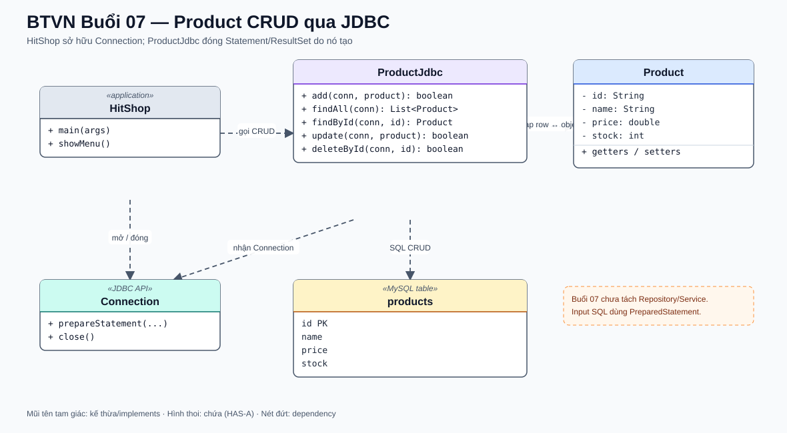

# Bài Tập Về Nhà — Buổi 07

## Bài Bắt Buộc — Product CRUD Qua JDBC

### Kế Thừa Từ Buổi 06

Tiếp tục repository `HitShop` bằng JDK 17 và Product P01/P02/P03 đã dùng trong các buổi trước. Giữ nguyên model Product `(id, name, price, stock)`; thay nguồn lưu Product của ứng dụng bằng MySQL để các chức năng giỏ/đơn tiếp tục dùng đúng mã sản phẩm. File Order ở buổi 6 chỉ còn là bài thực hành I/O, không phải nguồn dữ liệu của catalog.

### Bài Toán

Thay nguồn đọc/ghi Product bằng MySQL. Chương trình console phải thực hiện đủ tạo, xem danh sách, xem theo mã, cập nhật và xóa Product.

### Lược Đồ Cố Định

- Database: `shop_db`; bảng: `products`.
- Cột: `id VARCHAR(20) PRIMARY KEY`, `name VARCHAR(150) NOT NULL`, `price DECIMAL(12,2) NOT NULL`, `stock INT NOT NULL`.
- `id` không rỗng và duy nhất; `name` không rỗng; `price > 0`; `stock >= 0`.
- JDBC URL, username, password được cung cấp qua cấu hình cục bộ, không viết mật khẩu thật trong source và không đưa file bí mật lên repository.
- Lớp thao tác tên `ProductJdbc`; các method là `boolean add(Connection, Product)`, `List<Product> findAll(Connection)`, `Product findById(Connection, String)` (trả `null` nếu không tồn tại), `boolean update(Connection, Product)` và `boolean deleteById(Connection, String)`.
- Class chạy là `HitShop`; menu cố định: `1` thêm, `2` liệt kê, `3` tìm theo mã, `4` cập nhật, `5` xóa, `0` thoát. Lựa chọn khác báo `Lựa chọn không hợp lệ.` và hiện lại menu.
- Connection, PreparedStatement/Statement và ResultSet phải được giải phóng sau thao tác. Input được truyền dưới dạng tham số SQL, không ghép trực tiếp vào câu lệnh.
- Thao tác liệt kê dùng `Statement` cho câu SQL cố định; các thao tác có dữ liệu nhập dùng `PreparedStatement`.
- `HitShop` sở hữu Connection cho một thao tác menu; `ProductJdbc` không đóng Connection do caller mở, nhưng đóng Statement và ResultSet do method tạo ra. Sau thao tác, HitShop đóng Connection.

### Sơ Đồ Lớp Và Quan Hệ

`HitShop` mở và đóng `Connection`, sau đó truyền connection cùng `Product` vào `ProductJdbc`; lớp JDBC ánh xạ object với bảng `products`.

### Hành Vi Bắt Buộc

- Thêm Product mới theo đủ bốn trường; mã trùng phải bị từ chối và không sửa bản ghi cũ.
- Danh sách được in theo thứ tự tăng dần của `id`; tìm theo id chỉ trả tối đa một bản ghi.
- Cập nhật theo `id` đã tồn tại; chỉ `name`, `price`, `stock` được thay đổi, khóa `id` không đổi. Mã không tồn tại phải báo `Không tìm thấy sản phẩm.`
- Xóa theo `id`; mã không tồn tại phải báo cùng thông báo trên.
- Tất cả thao tác thay đổi dữ liệu chỉ báo thành công khi database xác nhận có đúng một dòng được tác động.
- Input không thỏa các ràng buộc id/name/price/stock bị từ chối trước khi ghi.

### Bộ Dữ Liệu Chuẩn Và Kết Quả

| id | name | price | stock |
|---|---|---:|---:|
| P01 | Áo thun | 150000.00 | 20 |
| P02 | Bình nước | 50000.00 | 10 |
| P03 | Java cơ bản | 120000.00 | 5 |

Sau khi thêm P04 `/ Sổ tay / 30000 / 15`, danh sách có 4 dòng. Cập nhật P04 thành giá `35000`, stock `12`; xóa P04 thì danh sách lại còn P01, P02 và P03 như trước. Tìm P99 phải báo không tìm thấy. Các bài kiểm tra CRUD không làm biến đổi bộ dữ liệu chuẩn dùng cho buổi sau.

### Nộp Bài

Repository gồm source, script tạo database/bảng và dữ liệu chuẩn; tài liệu cấu hình mẫu không chứa credential thật. Không yêu cầu Repository/Service hay bảng khách hàng ở buổi này.
