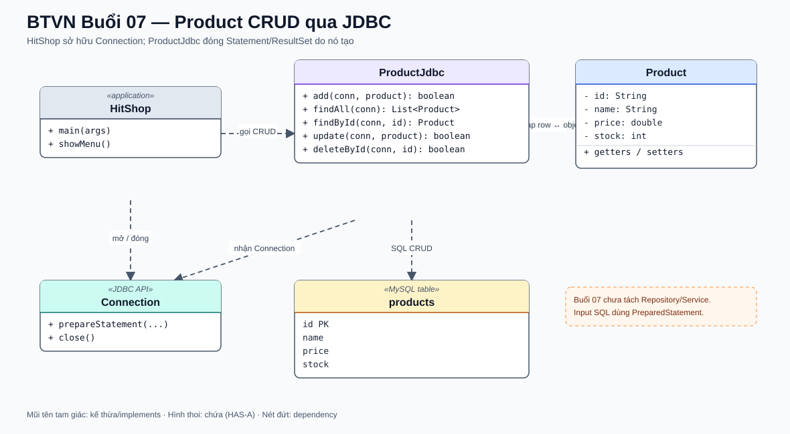

# Bài Tập Về Nhà — Buổi 07

## I. Tổng Kết Bài Tập Về Nhà Buổi 06

Sau bài tập buổi 6, project đã kiểm tra Order trước khi ghi và có thể lưu/đọc một đơn hàng qua file `orders.txt` bằng UTF-8.

### 1. Các Test Case Phải Chạy Được

| Mã | Thao tác | Kết quả mong đợi |
|---|---|---|
| `TC06-01` | Lưu O01 gồm `P01 × 2`, `P02 × 1` | File có đúng khối ORDER/ITEM/END |
| `TC06-02` | Đọc lại `orders.txt` | Tổng tính từ các dòng ITEM bằng `350000.0` |
| `TC06-03` | Đọc khi file chưa tồn tại | Trả danh sách rỗng và báo chưa có dữ liệu |
| `TC06-04` | Lưu Order rỗng hoặc item có quantity `0` | Báo lỗi nghiệp vụ và không ghi file |
| `TC06-05` | Ghi vào đường dẫn không hợp lệ | Báo lỗi I/O và không báo thành công |

### 2. Cây Thư Mục Sau Buổi 06

Cấu trúc source tối thiểu cần đạt:

```text
orders.txt
src/
├── HitShop.java
├── model/
│   ├── Product.java
│   ├── Book.java
│   ├── Customer.java
│   ├── CartItem.java
│   └── Order.java
├── payment/
├── delivery/
├── validation/OrderValidator.java
└── storage/OrderFileStore.java
```

## II. Bài Bắt Buộc — Product CRUD Qua JDBC

### 1. Kế Thừa Từ Buổi 06

Tiếp tục repository `HitShop` bằng JDK 17 và Product P01/P02/P03 đã dùng trong các buổi trước. Giữ nguyên model Product `(id, name, price, stock)`; thay nguồn lưu Product của ứng dụng bằng MySQL để các chức năng giỏ/đơn tiếp tục dùng đúng mã sản phẩm.

### 2. Bài Toán

Thay nguồn đọc/ghi Product bằng MySQL. Chương trình console phải thực hiện đủ tạo, xem danh sách, xem theo mã, cập nhật và xóa Product.

### 3. Lược Đồ Cố Định

- Database: `shop_db`; bảng: `products`.
- Cột: `id VARCHAR(20) PRIMARY KEY`, `name VARCHAR(150) NOT NULL`, `price DECIMAL(12,2) NOT NULL`, `stock INT NOT NULL`.
- `id` không rỗng và duy nhất; `name` không rỗng; `price > 0`; `stock >= 0`.
- JDBC URL, username, password được cung cấp qua cấu hình cục bộ, không viết mật khẩu thật trong source và không đưa file bí mật lên repository.
- Lớp thao tác dữ liệu tên `ProductJdbc`.
  - `boolean add(Connection, Product)`;
  - `List<Product> findAll(Connection)`;
  - `Product findById(Connection, String)`, trả `null` nếu không tồn tại;
  - `boolean update(Connection, Product)`;
  - `boolean deleteById(Connection, String)`.
- Class chạy là `HitShop`; menu cố định: `1` thêm, `2` liệt kê, `3` tìm theo mã, `4` cập nhật, `5` xóa, `0` thoát. Lựa chọn khác báo `Lựa chọn không hợp lệ.` và hiện lại menu.
- Connection, PreparedStatement/Statement và ResultSet phải được giải phóng sau thao tác. Input được truyền dưới dạng tham số SQL, không ghép trực tiếp vào câu lệnh.
- Thao tác liệt kê dùng `Statement` cho câu SQL cố định; các thao tác có dữ liệu nhập dùng `PreparedStatement`.
- `HitShop` sở hữu Connection cho một thao tác menu; `ProductJdbc` không đóng Connection do caller mở, nhưng đóng Statement và ResultSet do method tạo ra. Sau thao tác, HitShop đóng Connection.

### 4. Sơ Đồ Lớp Và Quan Hệ



`HitShop` mở và đóng `Connection`, sau đó truyền connection cùng `Product` vào `ProductJdbc`; lớp JDBC ánh xạ object với bảng `products`.

### 5. Hành Vi Bắt Buộc

- Thêm Product mới theo đủ bốn trường; mã trùng phải bị từ chối và không sửa bản ghi cũ.
- Danh sách được in theo thứ tự tăng dần của `id`; tìm theo id chỉ trả tối đa một bản ghi.
- Cập nhật theo `id` đã tồn tại; chỉ `name`, `price`, `stock` được thay đổi, khóa `id` không đổi. Mã không tồn tại phải báo `Không tìm thấy sản phẩm.`
- Xóa theo `id`; mã không tồn tại phải báo cùng thông báo trên.
- Tất cả thao tác thay đổi dữ liệu chỉ báo thành công khi database xác nhận có đúng một dòng được tác động.
- Input không thỏa các ràng buộc id/name/price/stock bị từ chối trước khi ghi.

### 6. Bộ Dữ Liệu Chuẩn Và Kết Quả

| id | name | price | stock |
|---|---|---:|---:|
| P01 | Áo thun | 150000.00 | 20 |
| P02 | Bình nước | 50000.00 | 10 |
| P03 | Java cơ bản | 120000.00 | 5 |

Sau khi thêm P04 `/ Sổ tay / 30000 / 15`, danh sách có 4 dòng. Cập nhật P04 thành giá `35000`, stock `12`; xóa P04 thì danh sách lại còn P01, P02 và P03 như trước. Tìm P99 phải báo không tìm thấy. Sau các ca kiểm thử, dữ liệu trở về đúng ba Product P01, P02 và P03.

### 7. Nộp Bài

Repository gồm source, script tạo database/bảng và dữ liệu chuẩn; tài liệu cấu hình mẫu không chứa credential thật.

## III. Tổng Kết Bài Tập Về Nhà Buổi 07

Sau bài tập buổi 7, catalog Product được lưu trong MySQL và chương trình thực hiện CRUD bằng JDBC với câu SQL có tham số.

### 1. Các Test Case Phải Chạy Được

Reset database về ba Product chuẩn trước khi chạy bộ test.

| Mã | Thao tác | Kết quả mong đợi |
|---|---|---|
| `TC07-01` | Liệt kê Product | Có đúng P01, P02, P03 theo thứ tự id tăng dần |
| `TC07-02` | Thêm `P04 / Sổ tay / 30000 / 15` | Database thêm đúng một dòng và danh sách có bốn Product |
| `TC07-03` | Thêm lại mã P01 | Database từ chối trùng khóa và dữ liệu P01 cũ không đổi |
| `TC07-04` | Tìm P01 rồi tìm P99 | P01 trả đúng dữ liệu; P99 báo `Không tìm thấy sản phẩm.` |
| `TC07-05` | Cập nhật P04 thành giá `35000`, stock `12` | Đúng một dòng P04 thay đổi, id giữ nguyên |
| `TC07-06` | Cập nhật hoặc xóa P99 | Trả thất bại và báo không tìm thấy |
| `TC07-07` | Xóa P04 | Đúng một dòng bị xóa; dữ liệu trở về P01, P02, P03 |
| `TC07-08` | Nhập Product có id/name rỗng, price không dương hoặc stock âm | Bị từ chối trước khi ghi database |

### 2. Cây Thư Mục Sau Buổi 07

Cấu trúc source tối thiểu liên quan trực tiếp đến phần JDBC:

```text
pom.xml
README.md
sql/
├── schema.sql
└── seed.sql
src/main/java/
├── HitShop.java
├── jdbc/
│   └── ProductJdbc.java
└── model/
    ├── Product.java
    ├── Book.java
    ├── Customer.java
    ├── CartItem.java
    └── Order.java
```
