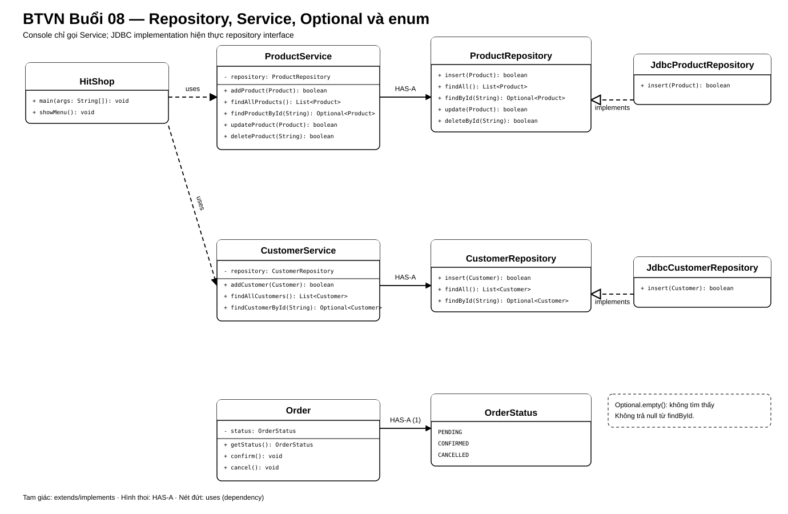

# Bài Tập Về Nhà — Buổi 08

## Bài Bắt Buộc — Tách Repository, Service Và Trạng Thái Đơn

### Kế Thừa Từ Buổi 07

Tiếp tục `HitShop` bằng JDK 17, bảng `products` và JDBC CRUD đã có. Buổi này không viết lại SQL theo một ứng dụng mới; hãy đưa code hiện có vào repository và để console đi qua service.

### Luồng Bắt Buộc

```text
HitShop/console → ProductService hoặc CustomerService → repository interface → JDBC implementation → MySQL
```

Console không gọi repository trực tiếp. Service không chứa SQL. JDBC implementation không đọc bàn phím hoặc in menu.

### Thành Phần Và Hợp Đồng

- `ProductRepository`:
  - `boolean insert(Product product)`;
  - `List<Product> findAll()`;
  - `Optional<Product> findById(String id)`;
  - `boolean update(Product product)`;
  - `boolean deleteById(String id)`.
- `JdbcProductRepository` implements `ProductRepository` và chuyển SQL CRUD buổi 7 vào đây.
- `ProductService` nhận `ProductRepository` qua constructor; có `addProduct`, `findAllProducts`, `findProductById`, `updateProduct`, `deleteProduct` với kiểu trả về tương ứng repository.
- Service từ chối Product có id/name rỗng, giá không dương hoặc stock âm trước khi gọi repository.
- Tạo bảng `customers(id VARCHAR(20) PRIMARY KEY, name VARCHAR(100) NOT NULL, phone VARCHAR(20) NOT NULL)`.
- `CustomerRepository` có `insert`, `findAll`, `findById`; `JdbcCustomerRepository` triển khai ba method.
- `CustomerService` nhận `CustomerRepository` qua constructor, kiểm tra id/name/phone không rỗng rồi mới thêm; cung cấp `addCustomer`, `findAllCustomers`, `findCustomerById`.
- `findById` và method tìm tương ứng của service trả `Optional.empty()` khi không có dữ liệu; không trả null.
- Tạo enum `OrderStatus { PENDING, CONFIRMED, CANCELLED }` và đổi field status của Order từ String sang enum; `getStatus()` đổi kiểu trả về thành `OrderStatus`. Các chuyển trạng thái của buổi 4 phải tiếp tục đúng.
- File `orders.txt` không còn là nguồn dữ liệu nghiệp vụ sau khi Order được chuyển vào MySQL ở buổi 9.

### Sơ Đồ Lớp Và Quan Hệ



Console gọi service; service nhận repository interface qua constructor; lớp JDBC implements interface. `Order` dùng `OrderStatus` thay cho chuỗi trạng thái.

### Dữ Liệu Nghiệm Thu

- Product: P01, P02, P03 như các buổi trước.
- Customer: `C01 / Linh Nguyễn / 0900000001`, `C02 / Minh Trần / 0900000002`.
- Tìm P01/C01 trả object đúng; tìm P99/C99 trả `Optional.empty()` và console báo rõ không tìm thấy.
- Product giá 0 hoặc Customer có phone rỗng bị service từ chối và không xuất hiện trong database.
- Order mới có status `PENDING`; xác nhận thành `CONFIRMED`; không thể hủy lại order đã xác nhận.

### Nộp Bài

Nộp schema customers, source repository/service, enum và output chạy qua menu console. Trong README, chỉ ra một luồng cụ thể từ console tới service rồi repository.

## Mở Rộng — Bài Tự Chọn

- Tạo record `ProductSummary(String id, String name, double price)` và method chuyển Product thành dữ liệu chỉ đọc để hiển thị.
- Viết unit test service bằng một repository in-memory.
- Chuẩn hóa lỗi nghiệp vụ bằng custom exception.

`record`/DTO chỉ là phần giới thiệu ở buổi này; không làm không ảnh hưởng yêu cầu lõi.
