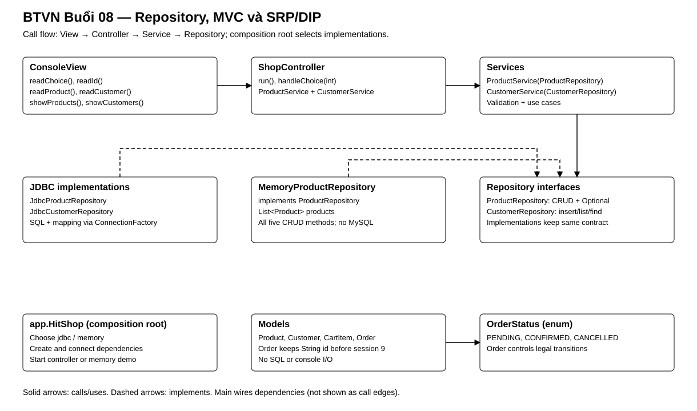

# Bài Tập Về Nhà — Buổi 08

## I. Tổng Kết Bài Tập Về Nhà Buổi 07

Sau bài tập buổi 7, project đã chuyển catalog Product sang MySQL và hoàn thành CRUD qua JDBC.

### 1. Các Test Case Phải Chạy Được

| Mã | Thao tác | Kết quả mong đợi |
|---|---|---|
| `TC07-01` | Liệt kê dữ liệu seed | Có đúng P01, P02, P03 theo thứ tự id |
| `TC07-02` | Thêm P04 hợp lệ rồi thêm lại mã P01 | P04 được thêm; mã trùng bị từ chối |
| `TC07-03` | Tìm P01 và P99 | P01 trả đúng dữ liệu; P99 báo không tìm thấy |
| `TC07-04` | Cập nhật name/price/stock của P04 | Đúng một row thay đổi, id không đổi |
| `TC07-05` | Xóa P04 rồi xóa P99 | P04 bị xóa; P99 báo không tìm thấy |
| `TC07-06` | Nhập dữ liệu vi phạm ràng buộc | Bị từ chối trước khi ghi database |

### 2. Cây Thư Mục Sau Buổi 07

Cấu trúc source tối thiểu liên quan trực tiếp đến phần JDBC:

```text
pom.xml
README.md
sql/
├── schema.sql
└── seed.sql
src/main/java/
├── HitShop.java
├── jdbc/ProductJdbc.java
└── model/
    ├── Product.java
    ├── Book.java
    ├── Customer.java
    ├── CartItem.java
    └── Order.java
```

## II. Bài Bắt Buộc — Tách Repository, Service Và Trạng Thái Đơn

### 1. Kế Thừa Từ Buổi 07

Tiếp tục `HitShop` bằng JDK 17, bảng `products` và JDBC CRUD đã có. Đưa code truy cập dữ liệu hiện có vào repository và để console gọi qua service.

### 2. Luồng Bắt Buộc

```text
HitShop/console → ProductService hoặc CustomerService → repository interface → JDBC implementation → MySQL
```

Console không gọi repository trực tiếp. Service không chứa SQL. JDBC implementation không đọc bàn phím hoặc in menu.

### 3. Thành Phần Và Hợp Đồng

- `ProductRepository`:
  - `boolean insert(Product product)`;
  - `List<Product> findAll()`;
  - `Optional<Product> findById(String id)`;
  - `boolean update(Product product)`;
  - `boolean deleteById(String id)`.
- `JdbcProductRepository` implements `ProductRepository` và chuyển SQL CRUD buổi 7 vào đây.
- `ProductService` nhận `ProductRepository` qua constructor; có `addProduct`, `findAllProducts`, `findProductById`, `updateProduct`, `deleteProduct` với kiểu trả về tương ứng repository.
- Service từ chối Product có id/name rỗng, giá không dương hoặc stock âm trước khi gọi repository.
- Tạo bảng `customers(id VARCHAR(20) PRIMARY KEY, name VARCHAR(100) NOT NULL, phone VARCHAR(20) NOT NULL)`.
- `CustomerRepository` có `insert`, `findAll`, `findById`; `JdbcCustomerRepository` triển khai ba method.
- `CustomerService` nhận `CustomerRepository` qua constructor, kiểm tra id/name/phone không rỗng rồi mới thêm; cung cấp `addCustomer`, `findAllCustomers`, `findCustomerById`.
- `findById` và method tìm tương ứng của service trả `Optional.empty()` khi không có dữ liệu; không trả null.
- Tạo enum `OrderStatus { PENDING, CONFIRMED, CANCELLED }` và đổi field status của Order từ String sang enum; `getStatus()` đổi kiểu trả về thành `OrderStatus`. Các chuyển trạng thái của buổi 4 phải tiếp tục đúng.

### 4. Sơ Đồ Lớp Và Quan Hệ



Console gọi service; service nhận repository interface qua constructor; lớp JDBC implements interface. `Order` dùng `OrderStatus` thay cho chuỗi trạng thái.

### 5. Dữ Liệu Nghiệm Thu

- Product: P01, P02, P03 như các buổi trước.
- Customer: `C01 / Linh Nguyễn / 0900000001`, `C02 / Minh Trần / 0900000002`.
- Tìm P01 trả đúng Product và tìm C01 trả đúng Customer. Tìm P99 hoặc C99 trả `Optional.empty()`; console hiển thị thông báo không tìm thấy.
- Product có giá 0 hoặc Customer có số điện thoại rỗng bị service từ chối và không được ghi vào database.
- Order mới có status `PENDING`; xác nhận thành `CONFIRMED`; không thể hủy lại order đã xác nhận.

### 6. Nộp Bài

Nộp schema customers, source repository/service, enum và output chạy qua menu console. Trong README, chỉ ra một luồng cụ thể từ console tới service rồi repository.

## III. Mở Rộng — Bài Tự Chọn

- Tạo record `ProductSummary(String id, String name, double price)` và method chuyển một `Product` thành `ProductSummary` để hiển thị.
- Viết unit test service bằng một repository in-memory.
- Chuẩn hóa lỗi nghiệp vụ bằng custom exception.

## IV. Tổng Kết Bài Tập Về Nhà Buổi 08

Sau bài tập buổi 8, console chỉ gọi Service, Service phụ thuộc repository interface, JDBC implementation chứa SQL và trạng thái Order dùng enum.

### 1. Các Test Case Phải Chạy Được

| Mã | Thao tác | Kết quả mong đợi |
|---|---|---|
| `TC08-01` | Chạy lại CRUD Product qua console | Kết quả giống buổi 7 nhưng console đi qua `ProductService` |
| `TC08-02` | Tìm P01 rồi P99 | Trả `Optional` có P01; P99 là `Optional.empty()` và console báo không tìm thấy |
| `TC08-03` | Thêm Product có giá `0` hoặc stock âm | Service từ chối trước khi repository được gọi |
| `TC08-04` | Thêm C01, C02 rồi liệt kê | Database có đúng hai Customer chuẩn |
| `TC08-05` | Tìm C01 rồi C99 | C01 trả đúng Customer; C99 là `Optional.empty()` |
| `TC08-06` | Thêm Customer có phone rỗng | Service từ chối và database không đổi |
| `TC08-07` | Tạo Order mới, gọi `confirm()` rồi `cancel()` | Trạng thái đi từ `PENDING` sang `CONFIRMED` và không thể hủy lại |
| `TC08-08` | Tìm toàn source theo chuỗi SQL | SQL chỉ nằm trong các JDBC repository, không nằm trong console hoặc service |

### 2. Cây Thư Mục Sau Buổi 08

Cấu trúc source tối thiểu của phần bắt buộc; các package cũ vẫn được giữ nếu còn được sử dụng:

```text
pom.xml
README.md
sql/
├── schema.sql
└── seed.sql
src/main/java/
├── HitShop.java
├── config/
│   └── ConnectionFactory.java
├── model/
│   ├── Product.java
│   ├── Customer.java
│   ├── CartItem.java
│   ├── Order.java
│   └── OrderStatus.java
├── repository/
│   ├── ProductRepository.java
│   ├── CustomerRepository.java
│   └── jdbc/
│       ├── JdbcProductRepository.java
│       └── JdbcCustomerRepository.java
└── service/
    ├── ProductService.java
    └── CustomerService.java
```
