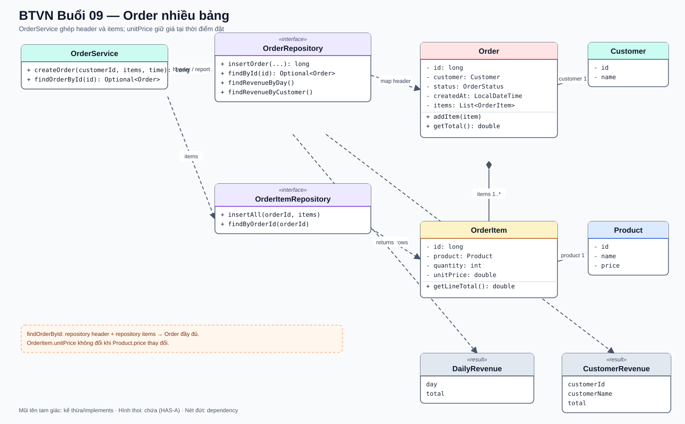

# Bài Tập Về Nhà — Buổi 09

## Bài Bắt Buộc — Đơn Hàng Nhiều Bảng, JOIN Và Báo Cáo

### Mốc Chuyển Mô Hình

Tiếp tục repository `HitShop` bằng JDK 17 và database buổi 8. Từ buổi này, Order được lưu trong MySQL và `orders.id` là `BIGINT AUTO_INCREMENT`; mã chuỗi `O01` của giai đoạn file được thay bằng id số như `1`. Không duy trì đồng thời hai kiểu id trong model Order.

### Schema Bắt Buộc

```sql
CREATE TABLE orders (
    id BIGINT PRIMARY KEY AUTO_INCREMENT,
    customer_id VARCHAR(20) NOT NULL,
    status VARCHAR(20) NOT NULL,
    created_at DATETIME NOT NULL,
    FOREIGN KEY (customer_id) REFERENCES customers(id)
);

CREATE TABLE order_items (
    id BIGINT PRIMARY KEY AUTO_INCREMENT,
    order_id BIGINT NOT NULL,
    product_id VARCHAR(20) NOT NULL,
    quantity INT NOT NULL,
    unit_price DECIMAL(12,2) NOT NULL,
    FOREIGN KEY (order_id) REFERENCES orders(id),
    FOREIGN KEY (product_id) REFERENCES products(id)
);
```

`quantity > 0`; `unit_price > 0`. `unit_price` là giá chốt khi mua, không đọc lại giá hiện tại để tính lịch sử đơn.

### Model Và Hợp Đồng Repository

- `Order`: `long id`, `Customer customer`, `OrderStatus status`, `LocalDateTime createdAt`, `List<OrderItem> items`; `addItem(OrderItem)` thêm một dòng và `getTotal()` cộng các line total.
- `OrderItem`: `long id`, `Product product`, `int quantity`, `double unitPrice`; `getLineTotal()` trả `quantity * unitPrice`.
- `OrderRepository.insertOrder(String customerId, OrderStatus status, LocalDateTime createdAt): long` dùng generated key.
- `OrderRepository.findById(long id): Optional<Order>` nạp phần header và Customer, khởi tạo items rỗng.
- `OrderItemRepository.insertAll(long orderId, List<OrderItem> items): void`.
- `OrderItemRepository.findByOrderId(long orderId): List<OrderItem>` JOIN Product để tạo từng OrderItem.
- `OrderService.createOrder(String customerId, List<OrderItem> items, LocalDateTime createdAt): long` tạo Order trước rồi gắn generated id cho các item.
- `OrderService.findOrderById(long id): Optional<Order>` gọi cả hai repository và gắn danh sách item trước khi trả kết quả. View không tự ghép dữ liệu.
- `OrderRepository.findRevenueByDay(): List<DailyRevenue>`.
- `OrderRepository.findRevenueByCustomer(): List<CustomerRevenue>`.

### Sơ Đồ Lớp Và Quan Hệ



`OrderService` ghép phần header từ `OrderRepository` với các dòng từ `OrderItemRepository`; `Order` chứa nhiều `OrderItem`, và mỗi dòng giữ một `Product` cùng `unitPrice` đã chốt.

### Hành Vi Bắt Buộc

- Service từ chối customer không tồn tại, danh sách item rỗng, quantity không dương hoặc product không tồn tại.
- Tạo Order trước OrderItem và dùng đúng khóa tự tăng vừa nhận; không đoán id bằng `MAX(id)`.
- SQL nhận input dùng `PreparedStatement`.
- Xem đơn in id, Customer, thời gian, trạng thái, từng dòng hàng và tổng.
- Báo cáo ngày sắp xếp ngày tăng dần; báo cáo khách sắp xếp customer id tăng dần. Tổng là `SUM(quantity * unit_price)`.
- Phần bắt buộc được nghiệm thu với dữ liệu hợp lệ và database hoạt động ổn định. Transaction được thực hành ở phần nâng cao buổi này và trở thành yêu cầu bắt buộc ở capstone.

### Dữ Liệu Chuẩn

- Customers: C01/Linh Nguyễn, C02/Minh Trần.
- Product hiện tại: P01 giá 160000, P02 giá 50000.
- Order id 1: C01, `2026-01-15 10:00`, CONFIRMED; P01 × 2 với `unit_price=150000`, P02 × 1 với `unit_price=50000`; tổng `350000`.
- Order id 2: C02, `2026-01-15 11:00`, CONFIRMED; P02 × 3 với `unit_price=50000`; tổng `150000`.
- Báo cáo ngày `2026-01-15` là `500000`; C01 `350000`, C02 `150000`.
- Order 1 vẫn hiển thị giá P01 là 150000 dù catalog hiện tại là 160000.

### Nộp Bài

Nộp schema, seed, source repository/service và output tạo đơn, xem chi tiết, hai báo cáo. README ghi rõ bước reset database để id bắt đầu từ 1.

## Nâng Cao — Transaction Và Tối Ưu

- Đặt insert Order và toàn bộ OrderItem trong cùng transaction; cố ý làm một item lỗi để chứng minh không còn Order mồ côi.
- Batch insert OrderItem.
- Phân trang danh sách Order bằng `LIMIT/OFFSET`.
- Tách `OrderItemRowMapper` dùng chung cho các truy vấn item.
