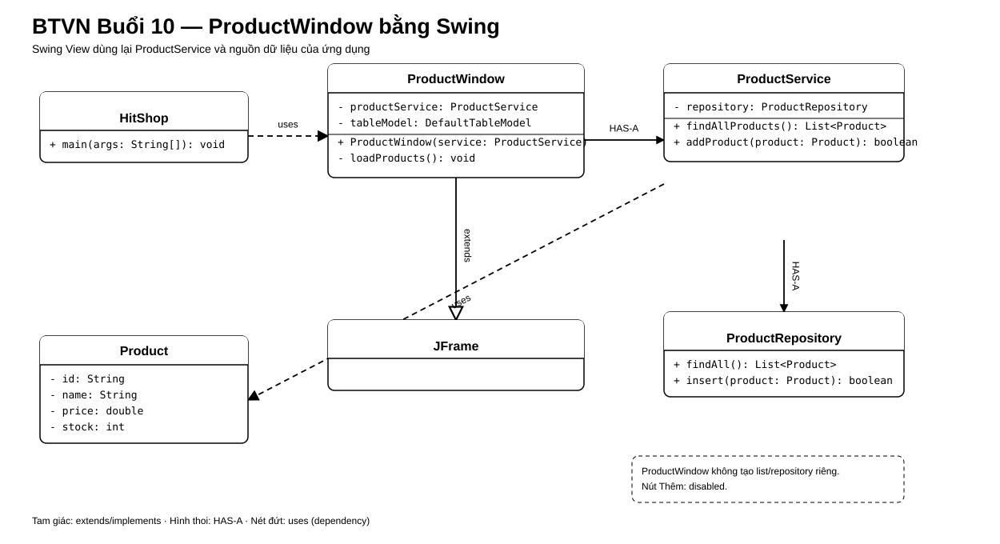

# Bài Tập Về Nhà — Buổi 10

## I. Tổng Kết Bài Tập Về Nhà Buổi 09

Sau bài tập buổi 9, project đã lưu Order/OrderItem trong các bảng quan hệ, giữ `unitPrice` lịch sử, nạp chi tiết bằng JOIN và lập báo cáo bằng phép tổng hợp.

### 1. Các Test Case Phải Chạy Được

| Mã | Thao tác | Kết quả mong đợi |
|---|---|---|
| `TC09-01` | Tạo Order 1 cho C01 với hai item chuẩn | Nhận generated id và lưu đúng header/items |
| `TC09-02` | Xem Order 1 sau khi giá hiện tại của P01 đổi | Tổng lịch sử vẫn bằng `350000` |
| `TC09-03` | Tạo Order với Customer/Product sai hoặc quantity không dương | Service từ chối |
| `TC09-04` | Chạy báo cáo ngày `2026-01-15` | Tổng doanh thu bằng `500000` |
| `TC09-05` | Chạy báo cáo theo Customer | C01 bằng `350000`, C02 bằng `150000` |
| `TC09-06` | Kiểm tra code insert Order | Dùng generated key, không dùng `MAX(id)` |

### 2. Cây Thư Mục Sau Buổi 09

Cấu trúc source tối thiểu của phần bắt buộc; các package cũ vẫn được giữ nếu còn được sử dụng:

```text
pom.xml
README.md
sql/
├── schema.sql
└── seed.sql
src/main/java/
├── HitShop.java
├── config/ConnectionFactory.java
├── dto/
│   ├── DailyRevenue.java
│   └── CustomerRevenue.java
├── model/
│   ├── Product.java
│   ├── Customer.java
│   ├── Order.java
│   ├── OrderItem.java
│   └── OrderStatus.java
├── repository/
│   ├── ProductRepository.java
│   ├── CustomerRepository.java
│   ├── OrderRepository.java
│   ├── OrderItemRepository.java
│   └── jdbc/
└── service/
    ├── ProductService.java
    ├── CustomerService.java
    └── OrderService.java
```

## II. Bài Bắt Buộc — Refactor HitShop Theo MVC Và DIP

### 1. Kế Thừa Từ Buổi 09

Tiếp tục đúng repository, database và hành vi Product/Customer/Order đã có bằng JDK 17. Giữ Order id kiểu `long`; dữ liệu mẫu là order id `1`, không quay lại `O01`. Bài này thay cách tổ chức code, không thay kết quả nghiệp vụ.

### 2. Cấu Trúc Package

```text
src/main/java/
├── app/HitShop.java
├── controller/ShopController.java
├── view/ConsoleView.java
├── dto/OrderItemInput.java
├── service/ProductService.java
├── service/CustomerService.java
├── service/OrderService.java
├── repository/ProductRepository.java
├── repository/CustomerRepository.java
├── repository/OrderRepository.java
├── repository/OrderItemRepository.java
├── repository/jdbc/JdbcProductRepository.java
├── repository/jdbc/JdbcCustomerRepository.java
├── repository/jdbc/JdbcOrderRepository.java
├── repository/jdbc/JdbcOrderItemRepository.java
├── model/Product.java
├── model/Customer.java
├── model/Order.java
└── model/OrderItem.java
```

### 3. Trách Nhiệm

- Model giữ dữ liệu và hành vi của entity, không in menu, không đọc input, không chứa SQL.
- `ConsoleView` hiển thị/nhận dữ liệu thô, không gọi service hoặc JDBC.
- `ShopController` điều phối request từ View sang Service, không chứa SQL hay quy tắc tồn kho.
- Service kiểm tra nghiệp vụ và phụ thuộc repository interface qua constructor.
- JDBC implementation chứa SQL và mapping, không in output giao diện.
- `HitShop.main` là composition root duy nhất: tạo DataSource/connection provider, repository implementation, service, view và controller rồi gọi `controller.run()`.

### 4. Dữ Liệu Nhập Đơn

View không tạo `OrderItem` hoàn chỉnh vì việc tra Product và chốt giá thuộc trách nhiệm của Service. Tạo record trong package `dto`:

```java
public record OrderItemInput(String productId, int quantity) {}
```

`ConsoleView.readOrderItems()` trả `List<OrderItemInput>`. Controller chuyển input sang Service; `OrderService` tra Product, kiểm tra quantity và tạo OrderItem với giá hiện tại. Không nhận `unitPrice` từ người dùng.

### 5. Hợp Đồng Chính

- `ShopController.run(): void`, `handleChoice(int): void`.
- `ConsoleView.showMenu(): void`, `readChoice(): int`, `readProduct(): Product`, `readCustomerId(): String`, `readOrderItems(): List<OrderItemInput>`, `readCreatedAt(): LocalDateTime` và các method hiển thị.
- Giữ các hợp đồng ProductService, CustomerService và repository của buổi 8–9.
- Thay chữ ký tạo đơn của `OrderService` bằng `createOrder(String customerId, List<OrderItemInput> inputs, LocalDateTime createdAt): long`.
- Không khai báo đồng thời hai method chỉ khác nhau ở kiểu generic `List<OrderItem>` và `List<OrderItemInput>` vì hai chữ ký có cùng kiểu sau type erasure.
- `OrderService.findOrderById(long)` vẫn trả Order đã có đầy đủ items.

### 6. Sơ Đồ Lớp Và Quan Hệ



Đọc sơ đồ theo luồng `View → Controller → Service → Repository interface → JDBC implementation`; `HitShop` chỉ khởi tạo và lắp các dependency tại composition root.

### 7. Nghiệm Thu Refactor

1. CRUD Product với P01/P02/P03 cho kết quả như trước refactor.
2. Tạo Order id 1 và xem lại đúng Customer, danh sách item, unit price và tổng tiền.
3. Chỉ ra được một luồng gọi hoàn chỉnh: View → Controller → Service → Repository interface → JDBC implementation.
4. Tìm trên toàn bộ repository và xác nhận không có SQL trong `view`, `controller`, `service` hoặc `model`.
5. Tạo `MemoryProductRepository implements ProductRepository`, khởi tạo P01/P02, truyền repository này vào ProductService rồi chạy chức năng tìm và liệt kê mà không sửa code Service.
6. README mô tả cấu hình database và hai cách chạy: JDBC repository và memory repository.

### 8. Nộp Bài

Nộp source theo package, README và output so sánh trước/sau refactor. Không đổi schema hoặc dữ liệu chuẩn chỉ để refactor dễ hơn.

## III. Bài Tự Chọn — Pattern

- `PaymentMethodFactory` nhận `CASH`/`BANK` và trả implementation tương ứng.
- Một lớp cấu hình duy nhất đọc credential từ biến môi trường hoặc file bị `.gitignore`; không hard-code mật khẩu.

## IV. Tổng Kết Bài Tập Về Nhà Buổi 10

Sau bài tập buổi 10, project có luồng phụ thuộc rõ `View → Controller → Service → Repository interface → JDBC implementation` và một composition root duy nhất để lắp dependency.

### 1. Các Test Case Phải Chạy Được

Chạy cùng dữ liệu chuẩn trước và sau refactor để chứng minh kết quả nghiệp vụ không đổi.

| Mã | Thao tác | Kết quả mong đợi |
|---|---|---|
| `TC10-01` | Chạy CRUD Product qua giao diện console | P01/P02/P03 và các thao tác CRUD cho kết quả như trước refactor |
| `TC10-02` | Tạo và xem Order id `1` | Customer, items, unit price và tổng tiền đúng như buổi 9 |
| `TC10-03` | Nhập `productId` và quantity khi tạo đơn | View chỉ tạo `OrderItemInput`; Service tra Product và chốt giá |
| `TC10-04` | Tìm toàn source theo chuỗi SQL | Không có SQL trong `view`, `controller`, `service`, `model` |
| `TC10-05` | Kiểm tra import/lời gọi từ View | View không gọi repository hoặc JDBC trực tiếp |
| `TC10-06` | Dùng `MemoryProductRepository` với cùng `ProductService` | Tìm và liệt kê P01/P02 mà không sửa code Service |
| `TC10-07` | Khởi động ứng dụng | `HitShop.main` chỉ tạo và nối dependency rồi gọi `controller.run()` |

### 2. Cây Thư Mục Sau Buổi 10

Cấu trúc source tối thiểu của phần bắt buộc; các package cũ vẫn được giữ nếu còn được sử dụng:

```text
src/main/java/
├── app/HitShop.java
├── controller/ShopController.java
├── view/ConsoleView.java
├── dto/OrderItemInput.java
├── service/
│   ├── ProductService.java
│   ├── CustomerService.java
│   └── OrderService.java
├── repository/
│   ├── ProductRepository.java
│   ├── CustomerRepository.java
│   ├── OrderRepository.java
│   ├── OrderItemRepository.java
│   ├── MemoryProductRepository.java
│   └── jdbc/
│       ├── JdbcProductRepository.java
│       ├── JdbcCustomerRepository.java
│       ├── JdbcOrderRepository.java
│       └── JdbcOrderItemRepository.java
└── model/
    ├── Product.java
    ├── Customer.java
    ├── Order.java
    ├── OrderItem.java
    └── OrderStatus.java
```
