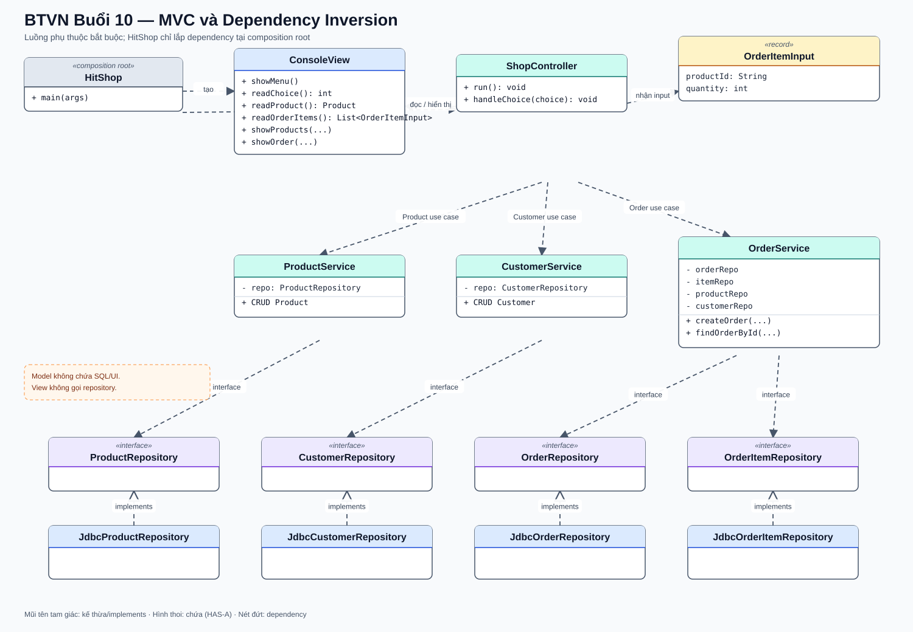

# Bài Tập Về Nhà — Buổi 10

## Bài Bắt Buộc — Refactor HitShop Theo MVC Và DIP

### Kế Thừa Từ Buổi 09

Tiếp tục đúng repository, database và hành vi Product/Customer/Order đã có bằng JDK 17. Giữ Order id kiểu `long`; dữ liệu mẫu là order id `1`, không quay lại `O01`. Bài này thay cách tổ chức code, không thay kết quả nghiệp vụ.

### Cấu Trúc Package

```text
src/main/java/
├── app/HitShop.java
├── controller/ShopController.java
├── view/ConsoleView.java
├── dto/OrderItemInput.java
├── service/ProductService.java
├── service/CustomerService.java
├── service/OrderService.java
├── repository/ProductRepository.java
├── repository/CustomerRepository.java
├── repository/OrderRepository.java
├── repository/OrderItemRepository.java
├── repository/jdbc/JdbcProductRepository.java
├── repository/jdbc/JdbcCustomerRepository.java
├── repository/jdbc/JdbcOrderRepository.java
├── repository/jdbc/JdbcOrderItemRepository.java
├── model/Product.java
├── model/Customer.java
├── model/Order.java
└── model/OrderItem.java
```

### Trách Nhiệm

- Model giữ dữ liệu và hành vi của entity, không in menu, không đọc input, không chứa SQL.
- `ConsoleView` hiển thị/nhận dữ liệu thô, không gọi service hoặc JDBC.
- `ShopController` điều phối request từ View sang Service, không chứa SQL hay quy tắc tồn kho.
- Service kiểm tra nghiệp vụ và phụ thuộc repository interface qua constructor.
- JDBC implementation chứa SQL và mapping, không in output giao diện.
- `HitShop.main` là composition root duy nhất: tạo DataSource/connection provider, repository implementation, service, view và controller rồi gọi `controller.run()`.

### Dữ Liệu Nhập Đơn

View không tạo `OrderItem` hoàn chỉnh vì việc tra Product và chốt giá thuộc trách nhiệm của Service. Tạo record trong package `dto`:

```java
public record OrderItemInput(String productId, int quantity) {}
```

`ConsoleView.readOrderItems()` trả `List<OrderItemInput>`. Controller chuyển input sang Service; `OrderService` tra Product, kiểm tra quantity và tạo OrderItem với giá hiện tại. Không nhận `unitPrice` từ người dùng.

### Hợp Đồng Chính

- `ShopController.run(): void`, `handleChoice(int): void`.
- `ConsoleView.showMenu(): void`, `readChoice(): int`, `readProduct(): Product`, `readCustomerId(): String`, `readOrderItems(): List<OrderItemInput>`, `readCreatedAt(): LocalDateTime` và các method hiển thị.
- Giữ các hợp đồng ProductService, CustomerService và repository của buổi 8–9.
- Thay chữ ký tạo đơn của `OrderService` bằng `createOrder(String customerId, List<OrderItemInput> inputs, LocalDateTime createdAt): long`.
- Không khai báo đồng thời hai method chỉ khác nhau ở kiểu generic `List<OrderItem>` và `List<OrderItemInput>` vì hai chữ ký có cùng kiểu sau type erasure.
- `OrderService.findOrderById(long)` vẫn trả Order đã có đầy đủ items.

### Sơ Đồ Lớp Và Quan Hệ



Đọc sơ đồ theo luồng `View → Controller → Service → Repository interface → JDBC implementation`; `HitShop` chỉ khởi tạo và lắp các dependency tại composition root.

### Nghiệm Thu Refactor

1. CRUD Product với P01/P02/P03 cho kết quả như trước refactor.
2. Tạo Order id 1 và xem lại đúng Customer, danh sách item, unit price và tổng tiền.
3. Chỉ ra được một luồng gọi hoàn chỉnh: View → Controller → Service → Repository interface → JDBC implementation.
4. Tìm trên toàn bộ repository và xác nhận không có SQL trong `view`, `controller`, `service` hoặc `model`.
5. Tạo `MemoryProductRepository implements ProductRepository`, khởi tạo P01/P02, truyền repository này vào ProductService rồi chạy chức năng tìm và liệt kê mà không sửa code Service.
6. README mô tả cấu hình database và hai cách chạy: JDBC repository và memory repository.

### Nộp Bài

Nộp source theo package, README và output so sánh trước/sau refactor. Không đổi schema hoặc dữ liệu chuẩn chỉ để refactor dễ hơn.

## Bài Tự Chọn — Pattern

- `PaymentMethodFactory` nhận `CASH`/`BANK` và trả implementation tương ứng.
- Một lớp cấu hình duy nhất đọc credential từ biến môi trường hoặc file bị `.gitignore`; không hard-code mật khẩu.
