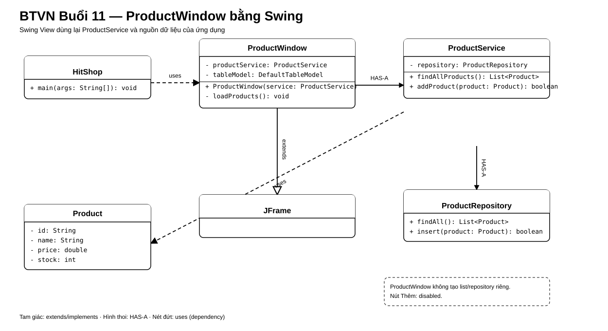

# Bài Tập Về Nhà — Buổi 11

## I. Tổng Kết Bài Tập Về Nhà Buổi 10

Sau bài tập buổi 10, project đã được refactor theo luồng View → Controller → Service → Repository interface → JDBC implementation và giữ nguyên hành vi nghiệp vụ.

### 1. Các Test Case Phải Chạy Được

| Mã | Thao tác | Kết quả mong đợi |
|---|---|---|
| `TC10-01` | Chạy CRUD Product sau refactor | Kết quả giống trước refactor |
| `TC10-02` | Tạo và xem Order id `1` | Customer, items, giá lịch sử và tổng đúng |
| `TC10-03` | Kiểm tra source các tầng | View không gọi JDBC; Controller không chứa nghiệp vụ; Service không chứa SQL |
| `TC10-04` | Chạy `ProductService` với JDBC repository | Đọc đúng dữ liệu MySQL |
| `TC10-05` | Chạy cùng `ProductService` với memory repository | Tìm/liệt kê Product mà không sửa Service |
| `TC10-06` | Khởi động ứng dụng | Composition root tạo và nối đầy đủ dependency |

### 2. Cây Thư Mục Sau Buổi 10

Cấu trúc source tối thiểu của phần bắt buộc; các package cũ vẫn được giữ nếu còn được sử dụng:

```text
src/main/java/
├── app/HitShop.java
├── controller/ShopController.java
├── view/ConsoleView.java
├── dto/OrderItemInput.java
├── service/
│   ├── ProductService.java
│   ├── CustomerService.java
│   └── OrderService.java
├── repository/
│   ├── ProductRepository.java
│   ├── CustomerRepository.java
│   ├── OrderRepository.java
│   ├── OrderItemRepository.java
│   ├── MemoryProductRepository.java
│   └── jdbc/
└── model/
    ├── Product.java
    ├── Customer.java
    ├── Order.java
    ├── OrderItem.java
    └── OrderStatus.java
```

## II. Bài Bắt Buộc — Form Và Bảng Product Bằng Swing

### 1. Kế Thừa Từ Buổi 10

Tiếp tục repository `HitShop` bằng JDK 17, class `HitShop` và `ProductService`/repository đã có. Thêm cửa sổ Swing làm View thay cho màn hình console; lấy Product từ cùng `ProductService`, không tạo danh sách sản phẩm hoặc repository riêng cho giao diện.

### 2. Bài Toán

Tạo một cửa sổ desktop để xem danh sách sản phẩm trong cửa hàng.

### 3. Cấu Trúc Giao Diện

- Một `JFrame` tiêu đề `Quản lý sản phẩm`, kích thước tối thiểu 700×450 px, đóng cửa sổ thì ứng dụng kết thúc.
- Một `JPanel` ở phía trên chứa nhãn `Tên sản phẩm`, một `JTextField` để trống khi mở ứng dụng, nhãn `Giá`, một `JTextField` để trống và một `JButton` chữ `Thêm`. Nút bị vô hiệu hóa bằng `setEnabled(false)`.
- Một `JTable` phía dưới nằm trong `JScrollPane`; có đúng các cột theo thứ tự `Mã`, `Tên sản phẩm`, `Đơn giá`, `Tồn kho`.
- Khi mở cửa sổ, bảng hiển thị các Product do `ProductService.findAllProducts()` trả về.
- Dữ liệu chuẩn gồm `P01 | Áo thun | 160000 | 20`, `P02 | Bình nước | 50000 | 10`, `P03 | Java cơ bản | 120000 | 5`.
- Catalog hiện tại lưu giá P01 là 160000; Order lịch sử vẫn giữ unit price 150000. Không tự tạo dữ liệu thay thế cho repository.
- Cửa sổ phải hiển thị đồng thời form và bảng; nhãn/cột không bị cắt ở kích thước quy định.
- Bắt buộc có JFrame, JPanel, JTextField, JButton, JTable. Kết nối dữ liệu vẫn dùng repository/service đã có.

### 4. Sơ Đồ Lớp Và Quan Hệ



`ProductWindow extends JFrame` và nhận `ProductService`; cửa sổ không tự tạo repository hoặc danh sách Product riêng.

### 5. Nộp Bài Theo Git

- Repository nhóm có các nhánh `main`, `develop` và `feature/product-window`.
- Commit có message bắt đầu bằng `feat:`.
- Tạo pull request vào `develop` với tiêu đề `Add product management window`, mô tả chức năng và ảnh cửa sổ đang chạy.
- Xử lý mọi comment review trước khi merge theo quy ước nhóm.

## III. Mở Rộng — Bài Tự Chọn Event Handling

Kích hoạt nút `Thêm`. Nút nhận tên và giá, gọi `ProductService.addProduct` để tạo mã mới tiếp sau mã lớn nhất hiện có (với dữ liệu chuẩn, mã đầu tiên là P04); tồn kho mặc định là 0. Tên rỗng hoặc giá không phải số dương thì bảng không đổi và giao diện báo lỗi.

## IV. Tổng Kết Bài Tập Về Nhà Buổi 11

Sau bài tập buổi 11, project có thêm một Swing View dùng lại `ProductService` và thay đổi được bàn giao qua feature branch, pull request cùng code review.

### 1. Các Test Case Phải Chạy Được

| Mã | Thao tác | Kết quả mong đợi |
|---|---|---|
| `TC11-01` | Mở `ProductWindow` ở kích thước 700×450 | Form phía trên và bảng phía dưới hiển thị đồng thời, nhãn/cột không bị cắt |
| `TC11-02` | Kiểm tra form khi vừa mở | Hai text field rỗng; nút `Thêm` bị vô hiệu hóa |
| `TC11-03` | Kiểm tra bảng Product | Có đúng bốn cột theo thứ tự `Mã`, `Tên sản phẩm`, `Đơn giá`, `Tồn kho` |
| `TC11-04` | Nạp dữ liệu qua `ProductService.findAllProducts()` | Bảng có P01, P02, P03 đúng dữ liệu chuẩn |
| `TC11-05` | Đổi dữ liệu repository rồi mở lại/nạp lại cửa sổ | Bảng phản ánh dữ liệu Service, không dùng list hard-code riêng |
| `TC11-06` | Tìm source của Swing View | Không có SQL và không tự tạo repository trong View |
| `TC11-07` | Kiểm tra Git | Có `feature/product-window`, commit `feat:...` và PR `Add product management window` vào `develop` |
| `TC11-08` | Chạy lại giao diện console | Các chức năng cũ vẫn hoạt động sau khi thêm Swing View |

### 2. Cây Thư Mục Sau Buổi 11

Cấu trúc source tối thiểu của phần bắt buộc; các package cũ vẫn được giữ nếu còn được sử dụng:

```text
src/main/java/
├── app/HitShop.java
├── controller/ShopController.java
├── view/
│   ├── ConsoleView.java
│   └── ProductWindow.java
├── dto/OrderItemInput.java
├── service/
│   ├── ProductService.java
│   ├── CustomerService.java
│   └── OrderService.java
├── repository/
│   ├── ProductRepository.java
│   ├── CustomerRepository.java
│   ├── OrderRepository.java
│   ├── OrderItemRepository.java
│   └── jdbc/
└── model/
    ├── Product.java
    ├── Customer.java
    ├── Order.java
    ├── OrderItem.java
    └── OrderStatus.java
```
