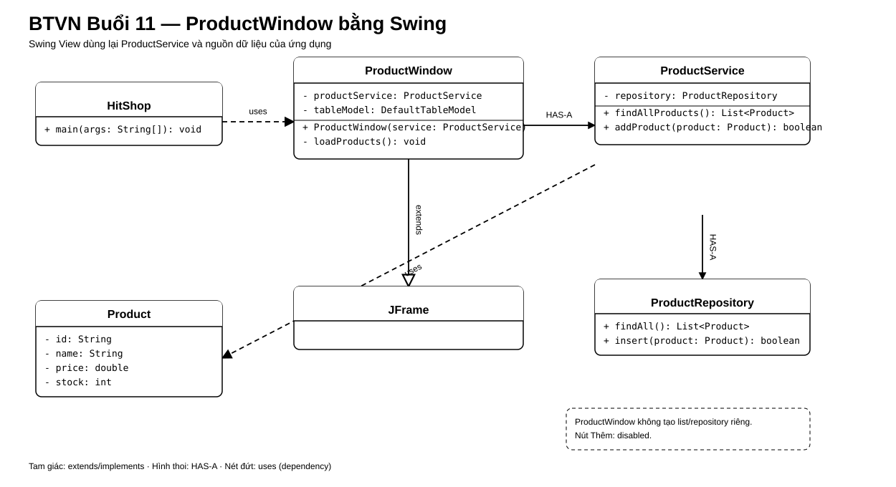

# Bài Tập Về Nhà — Buổi 11

## Bài Bắt Buộc — Form Và Bảng Product Bằng Swing

### Kế Thừa Từ Buổi 10

Tiếp tục repository `HitShop` bằng JDK 17, class `HitShop` và `ProductService`/repository đã có. Thêm cửa sổ Swing làm View thay cho màn hình console; lấy Product từ cùng `ProductService`, không tạo danh sách sản phẩm hoặc repository riêng cho giao diện.

### Bài Toán

Tạo một cửa sổ desktop để xem danh sách sản phẩm trong cửa hàng.

### Cấu Trúc Giao Diện

- Một `JFrame` tiêu đề `Quản lý sản phẩm`, kích thước tối thiểu 700×450 px, đóng cửa sổ thì ứng dụng kết thúc.
- Một `JPanel` ở phía trên chứa nhãn `Tên sản phẩm`, một `JTextField` để trống khi mở ứng dụng, nhãn `Giá`, một `JTextField` để trống và một `JButton` chữ `Thêm`. Nút bị vô hiệu hóa bằng `setEnabled(false)`.
- Một `JTable` phía dưới nằm trong `JScrollPane`; có đúng các cột theo thứ tự `Mã`, `Tên sản phẩm`, `Đơn giá`, `Tồn kho`.
- Khi mở cửa sổ, bảng hiển thị các Product do `ProductService.findAllProducts()` trả về.
- Dữ liệu chuẩn gồm `P01 | Áo thun | 160000 | 20`, `P02 | Bình nước | 50000 | 10`, `P03 | Java cơ bản | 120000 | 5`.
- Catalog hiện tại lưu giá P01 là 160000; Order lịch sử vẫn giữ unit price 150000. Không tự tạo dữ liệu thay thế cho repository.
- Cửa sổ phải hiển thị đồng thời form và bảng; nhãn/cột không bị cắt ở kích thước quy định.
- Bắt buộc có JFrame, JPanel, JTextField, JButton, JTable. Kết nối dữ liệu vẫn dùng repository/service đã có.

### Sơ Đồ Lớp Và Quan Hệ

`ProductWindow extends JFrame` và nhận `ProductService`; cửa sổ không tự tạo repository hoặc danh sách Product riêng.

### Nộp Bài Theo Git

- Repository nhóm có các nhánh `main`, `develop` và `feature/product-window`.
- Commit có message bắt đầu bằng `feat:`.
- Tạo pull request vào `develop` với tiêu đề `Add product management window`, mô tả chức năng và ảnh cửa sổ đang chạy.
- Xử lý mọi comment review trước khi merge theo quy ước nhóm.

## Mở Rộng — Bài Tự Chọn Event Handling

Kích hoạt nút `Thêm`. Nút nhận tên và giá, gọi `ProductService.addProduct` để tạo mã mới tiếp sau mã lớn nhất hiện có (với dữ liệu chuẩn, mã đầu tiên là P04); tồn kho mặc định là 0. Tên rỗng hoặc giá không phải số dương thì bảng không đổi và giao diện báo lỗi.
